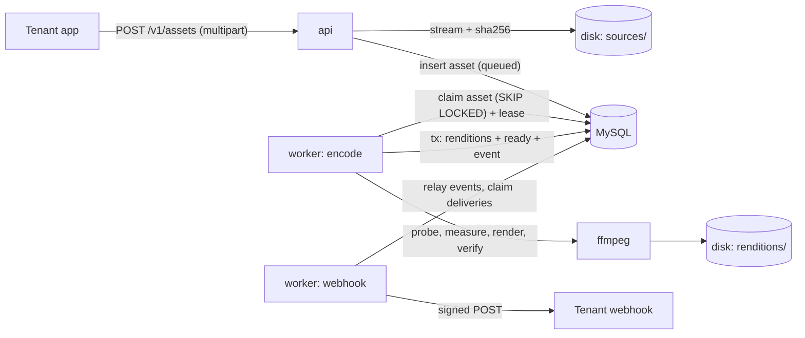

# SlumberMill

A multi-tenant audio ingest pipeline in Go. A tenant uploads a sleep story or soundscape;
the encode pool loudness-normalises it to the tenant's target, renders two AAC renditions and verifies each one,
and the webhook pool notifies the tenant with a signed webhook.

The scope is narrow on purpose: one upload path, two renditions, two event types.
The depth goes into what fails in production: concurrency on MySQL, tenant isolation, webhook delivery,
shutdown, and loudness that is verified rather than assumed.
[SPEC.md](SPEC.md) is the full design.



One binary with four subcommands. `migrate`, `api` and each worker pool run as their own Compose service;
`tenant create` runs as a one-off command in the `api` service:

```
slumber-mill migrate                 apply database migrations
slumber-mill api                     serve the HTTP API
slumber-mill worker -pool P          run a worker pool: encode or webhook
slumber-mill tenant create -slug S [-webhook-url U] [-target-lufs F]
```

## Quick start

The host needs Docker with Compose v2 and nothing else; `make` is optional. On Linux, if your user ID isn't 1000,
put `APP_UID=` followed by the output of `id -u` in a gitignored `.env` first: the containers write to `var/` as
that user.

```sh
docker compose up -d --build                               # MySQL, migrations, API and both pools
docker compose run --rm api tenant create -slug demo       # prints the API key once
docker compose run --rm --no-deps dev go test -race ./...  # unit tests only; MySQL isn't started
docker compose run --rm dev                                # the whole suite against the Compose MySQL
docker compose run --rm dev go vet -tags integration ./...
docker compose run --rm dev go test -tags integration -coverprofile=/out/cover.out ./...
```

A Makefile wraps these: `make up`, `make tenant SLUG=demo`, `make test-unit`, `make test`, `make vet`, `make fmt`,
`make tidy`, `make cover`, `make down` and `make process-checks`; the Checkly targets are under
[Monitoring with Checkly](#monitoring-with-checkly).

Export the key from the `api_key:` line that `tenant create` printed as `API_KEY`, upload a file, set `ASSET_ID` to
the `id` field of the 202 response, then poll until the asset's `status` is `ready` and download a rendition
(`aac_128k` or `aac_64k`):

```sh
export API_KEY=sm_...
curl -H "Authorization: Bearer $API_KEY" -F title=Rain -F file=@var/out/rain.wav http://127.0.0.1:8080/v1/assets
export ASSET_ID=...
curl -H "Authorization: Bearer $API_KEY" http://127.0.0.1:8080/v1/assets/$ASSET_ID
curl -H "Authorization: Bearer $API_KEY" -o rain-128k.m4a http://127.0.0.1:8080/v1/assets/$ASSET_ID/renditions/aac_128k
```

The API listens on `:8080` inside its container, and Compose publishes that port on `127.0.0.1` only, so the local
stack isn't open to the network. Uploads and renditions live in `var/data`, so they can be played from there.

### Input files

For a test file, generate 10 seconds of stereo pink noise with the ffmpeg in the `dev` service; it lands in
`var/out/rain.wav`, which the upload above reads:

```sh
docker compose run --rm --no-deps dev ffmpeg -hide_banner -loglevel error \
  -f lavfi -i anoisesrc=color=pink:amplitude=0.3:duration=10:seed=1 -ac 2 /out/rain.wav
```

- **Containers.** WAV, MP3, FLAC, Ogg, MP4 and MOV (so M4A), raw AAC, Matroska (so WebM) and AIFF. The encode
  pool tells ffmpeg to open only those, from a local file, so playlists such as HLS and concat are rejected.
  It takes the first audio stream, whatever its codec, as long as ffmpeg can decode it; video streams are ignored.
- **Size.** The whole request may be up to 2 GiB (`SLUMBER_MILL_MAX_UPLOAD_BYTES`), or the API answers
  `413 file_too_large`. A tenant may have 4 uploads in flight (`SLUMBER_MILL_MAX_UPLOADS_PER_TENANT`),
  and the next one gets `429 too_many_uploads`. A body that stalls for 30 seconds gets `408`.
  An empty file or a missing `title` is a `400 invalid_request`.
- **Duration.** From 3 seconds to 10 hours. Shorter files read as silent, and a longer one would not finish
  within the 5-hour encode timeout.
- **Channels.** `aac_64k` is always mono, and `aac_128k` keeps up to 2 channels: a stereo source stays stereo, a mono
  source gets a mono 128k file, and anything with more channels, such as 5.1, is downmixed to stereo. Each rendition
  is normalised after its own downmix, so both land on the tenant's target.
- **Rejections** aren't an upload error. The API answers 202, and the asset later turns `failed` with a message in
  its `error` field, which is safe to show a tenant: `not audio` (unparseable, no audio stream or a disallowed
  container), `too short`, `too long: the limit is 10 hours`, `silent`, or, if a rendition can't be brought to
  target even after the corrective re-encode, its loudness and true peak against the limits.
  Anything else is retried, and after three attempts ends as `processing failed after repeated attempts`.

### HTTP API

All `/v1` routes need `Authorization: Bearer sm_...`.

| Method and path | Behaviour |
|---|---|
| `POST /v1/assets` | Multipart `title` and `file`; 202 with the asset and a `Location` header |
| `GET /v1/assets/:id` | The asset; 404 for a missing one and for another tenant's, which look the same |
| `GET /v1/assets?limit=&cursor=` | Newest first; `limit` 1-100, default 20; `data` and `next_cursor` |
| `GET /v1/assets/:id/renditions/:profile` | The file, with Range support |
| `GET /healthz` | Liveness: always 200 |
| `GET /readyz` | Readiness: a database ping; 503 as soon as shutdown begins |

Errors look like `{"error": {"code": "not_found", "message": "no such asset"}}`.
`Idempotency-Key` (optional, printable ASCII, at most 255 bytes, compared byte for byte) makes a retried upload one
asset: the same key with the same file and title replays the asset with 202 and `Idempotent-Replayed: true`,
and the same key with a different upload is `422 idempotency_key_reused`.

### Webhooks

A tenant created with `-webhook-url` gets `asset.ready` and `asset.failed` events:
`{"id": "<uuid>", "type": "...", "created_at": "...", "data": <asset>}`, where `data` is the API's own asset shape.
The request is a POST with `SlumberMill-Event-Id` and `SlumberMill-Signature: t=<unix>,v1=<hex>`, where `v1` is
the HMAC-SHA256 of `<t>.<body>` under the tenant's webhook secret. Delivery is at-least-once and unordered,
so receivers dedupe on the event ID. A 2xx counts as delivered, 410 Gone stops retrying, and anything else,
redirects included, is retried until the delivery has had 12 attempts, with a backoff that starts at 30 seconds
and caps at 6 hours. The package `github.com/zanvd/slumber-mill/src/webhook` exports `Verify` for receivers;
it accepts several `v1` values so secrets can rotate.

## Operations

### Creating a tenant

`tenant create -slug S [-webhook-url U] [-target-lufs F]` prints the credentials on stdout, once and nowhere else:

```
api_key: sm_...
webhook_secret: whsec_...
```

The `webhook_secret` line appears only when the tenant has a `-webhook-url`. Only hashes and ciphertext are stored,
so if you lose them, they are gone. Logs go to stderr as JSON.
`-target-lufs` defaults to -20 and must be from -70 to -16, the loudest allowed. Tenants created before the
default changed keep their stored target.
The command refuses a webhook URL whose host isn't public.

Exit codes, for every subcommand: 0 for success or help, 1 for a runtime or configuration error,
and 2 for a usage error, such as a missing `-slug`.

### Configuration

Environment variables, with the defaults used when one is unset:

| Variable | Default |
|---|---|
| `SLUMBER_MILL_DSN` | `slumber_mill:slumber_mill@tcp(mysql:3306)/slumber_mill` |
| `SLUMBER_MILL_DATA_DIR` | `/data` |
| `SLUMBER_MILL_HTTP_ADDR` | `:8080` |
| `SLUMBER_MILL_MAX_UPLOAD_BYTES` | `2147483648` |
| `SLUMBER_MILL_MAX_UPLOADS_PER_TENANT` | `4` |
| `SLUMBER_MILL_ENCODE_CONCURRENCY` | `runtime.GOMAXPROCS(0)`, which follows the container's CPU limit |
| `SLUMBER_MILL_WEBHOOK_CONCURRENCY` | `8` |
| `SLUMBER_MILL_ENCODE_LEASE` | `2m` |
| `SLUMBER_MILL_SHUTDOWN_GRACE` | `30s` |
| `SLUMBER_MILL_DRAIN_DELAY` | `10s` (API: readiness fails, still serving) |
| `SLUMBER_MILL_TRUSTED_PROXIES` | empty: trust none |
| `SLUMBER_MILL_WEBHOOK_ALLOW_PRIVATE` | `false`; `true` in the local Compose stack |
| `SLUMBER_MILL_SECRET_KEYS` | none; `<id>:<base64 key>[,...]`, required by `tenant create` and the webhook pool |

- **Leases.** The encode lease is `SLUMBER_MILL_ENCODE_LEASE`, default 2 minutes, with a 1 minute minimum: a shorter
  value is a configuration error and the process exits 1. The `api` and both pools read it, because the startup
  sweep of `tmp/` removes files older than the lease. The webhook lease is fixed at 1 minute.
  A worker heartbeats every third of its lease.
- **Retention.** The webhook worker that holds the relay lock deletes deliveries in the `delivered` state
  30 days after delivery and relayed events 30 days after relay, in small batches. The other webhook workers don't.
  It runs when a worker takes the lock and then hourly while it holds it. The 30 days are fixed, not configurable.
  Assets and renditions are never deleted.
- **Logs.** The encode and webhook pools log one INFO `work claimed` record per claim, with the row's internal `id`,
  `tenant_id`, `attempt`, `worker` and `pool`, and one `work finished` record when the job ends.
- **The secret key.** Only `api` (which runs `tenant create`) and `worker-webhook` get `SLUMBER_MILL_SECRET_KEYS`.
  Compose sets a fixed key marked dev-only; production reads it from a secret manager.

### Shutdown and crashes

- `docker compose stop` sends SIGTERM. The encode pool stops claiming, gives the encodes in flight
  `SLUMBER_MILL_SHUTDOWN_GRACE` to finish, then cancels them and releases the asset to `queued` with its attempts
  unchanged. A second SIGTERM ends the process at once.
- `stop_grace_period` is 45 seconds in `compose.yaml`, and must stay above the grace: Docker's default of 10 seconds
  would kill every worker mid-encode.
- The API fails `/readyz` on SIGTERM, keeps serving for `SLUMBER_MILL_DRAIN_DELAY`, then shuts down within the grace,
  and exits 0 even when the grace runs out.
- A signal before the API listens ends it with exit 0 and the log line `stopped before serving HTTP`.
- After a SIGKILL or a crash, the reaper requeues the asset once its lease has expired and counts the attempt.
  The dead attempt's temp files wait for the next startup sweep.
- Outside containers, run workers under systemd with `KillMode=mixed` and a `TimeoutStopSec` above the grace.
  A worker killed outright orphans ffmpeg there; in a container the kernel kills it with the container.

### Process-level checks

`make process-checks` runs `scripts/process-checks.sh`, which checks how `worker-encode` stops and crashes
under Compose while it is encoding:

1. `docker compose stop` lets it drain for the shutdown grace, then release the asset to `queued` with its attempts
   unchanged, and exit 0 within `stop_grace_period`.
2. After a SIGKILL and a restart once the encode lease has passed, the asset is reaped and processed as attempt 2,
   and the dead attempt's temp files are swept.
3. With a stop timeout below the shutdown grace, check 1 fails: Docker kills the worker mid-drain and the asset isn't
   released. That's why `stop_grace_period` is longer than the grace.
4. A second SIGTERM during the drain ends the worker at once.

The script needs only bash 5 and Docker, and takes 6-8 minutes, mostly encoding and waiting out the lease.
It isn't run in CI. It works on a Compose project of its own, `<name>-process-checks`, where `<name>` is
`COMPOSE_PROJECT_NAME` or the checkout's directory name (lower-cased, anything outside `a-z0-9_-` removed), so it
never touches your everyday stack or another checkout's. It builds and starts that project,
and when it ends takes it down with its volumes and the images it built. It mounts `var/out/process-checks/data`
as the data directory instead of `var/data` and publishes no port, so it can run beside a local stack.
Uploads go through a pinned `curlimages/curl` container on the project's network. The containers' logs are left in
`var/out/process-checks/compose.log`.

### Full-stack soak

`bash scripts/soak.sh` runs the whole stack under load while it breaks parts of it. It isn't run in CI and has no
`make` target. `worker-encode` and `worker-webhook` run two replicas each, so each table has two reapers, and the
encode lease is its 1 minute minimum. A driver, the `soak` service in `scripts/soak.compose.yaml`, runs
`TestFullStackSoak` (build tag `soak`) from the `dev` image on the project's network. The script creates five
tenants with `tenant create` in the `api` service. Four have webhooks pointing at the driver's receiver; the fifth
has none, and their targets range from -16 to -23 LUFS. -16 is the loudest target `tenant create` accepts.

- **Uploads.** Ten uploaders go through the API for `SLUMBER_MILL_SOAK_DURATION` (default `10m`), and pause while
  12 assets are unfinished. They send 5-20 second stereo, mono and 5.1 noise fixtures from fixed seeds, an
  occasional 60 second thunder fixture, and text, silent and 1 second files, which are rejected. Every upload has an
  `Idempotency-Key`: 10% are replayed, 5% are sent twice at once, and 5% reuse their key for another file, which
  must be refused with 422. Connection errors and 429s are retried with the same key.
- **The receiver** verifies every signature. Its answer depends on the event ID: most events get a 2xx, some
  arrive slowly, and others get a 500 or a 302 once, two 503s, or a hang past the client's 15 second timeout.
  4% get a 410.
- **Failures.** Every `SLUMBER_MILL_SOAK_CHAOS_EVERY` seconds (default 45) the script injects one failure, taking
  them in turn. It sends SIGKILL to an encode worker or a webhook worker and restarts it 5-20 seconds later; that
  leaves leases for the other replica to reap, and a killed webhook worker that holds the relay lock loses it with
  its session. Before it kills a webhook worker it waits, for up to 3 minutes or until the uploads stop, until the
  worker has held a delivery for 5-12 seconds. Only a delivery the receiver is hanging on lasts that long, and it
  stays in flight for 15 seconds, so the kill leaves one leased. If none turns up in time, the kill goes ahead
  anyway. Or the script runs `docker stop` on a webhook worker or the API, then starts it again.
- **The checks.** When the uploads stop, the driver waits up to `SLUMBER_MILL_SOAK_DRAIN_TIMEOUT` (default `15m`)
  for every asset and delivery to finish and every event to be relayed. Then it checks these invariants:
  - the run did enough for the rest to mean something: every kind of upload, a ready asset, a failure with each
    rejection message, a download, a retried delivery and a delivery failed on a 410;
  - every asset is one of the soak's uploads, with one asset per idempotency key;
  - every finished asset has exactly one event matching its state, and every event has exactly one delivery,
    or none for the tenant without a webhook;
  - only `ready` assets have renditions, two each;
  - nothing is left leased, and attempts stay within each table's maximum;
  - every rendition is within 1 LU of its target and at or below -1.5 dBTP, and its file has the recorded size
    and hash; a sample is also downloaded through the API, whole and by range;
  - rejected uploads failed with the tenant-safe message;
  - every encode attempt beyond an asset's first followed a reap: the script compares the extra attempts in the
    database with the reapers' logged requeues, and fails a run in which nothing was requeued;
  - every delivered event reached the receiver signed and was answered with a 2xx, and only events answered
    with a 410 failed;
  - every webhook's asset equals the API's final asset.

  The script also checks that each stopped container exited 0, or 137 after a SIGKILL. A run that SIGKILLs a webhook
  worker fails unless at least one such kill found a delivery in flight and a reaper requeued at least one delivery.
  A hanging delivery is 6% of events, so a kill may find none within its wait. The webhook workers are killed by the
  2nd and 6th failures, and the 6th comes six intervals and three restarts in, about 5 minutes with the default
  interval. The reap checks need a run long enough for both kills, so set `SLUMBER_MILL_SOAK_DURATION` to `6m` or
  more; a shorter run has one kill, or none, and can fail the reap check by chance. The script also fails on any
  deadlock or lock wait timeout in the services' logs, and on any ERROR line. GORM logs the losing insert of two
  racing uploads with the same key as a `query failed` WARN, which is normal. The script counts those lines, and
  they may number no more than the driver's concurrent pairs plus its retries after a connection error.

A run takes the duration plus 3-5 minutes to build, start and drain. It uses about 4 of the host's CPUs for
the two encode workers. The project is `<name>-soak`, where `<name>` is `COMPOSE_PROJECT_NAME` or, as Compose
itself defaults it, the checkout's directory name in lower case. That keeps soaks run from two checkouts apart; if
the directory name has no letters, digits, hyphens or underscores, the script stops until `COMPOSE_PROJECT_NAME` is
set. The project uses `var/out/soak/data` as its data directory and publishes no port. At the end the script takes
the project down with its volumes and images. The driver's summary is left in `var/out/soak/summary.txt`, with its
log in `driver.log` and the services' logs in `compose.log`. Webhook delivery is at-least-once, so the summary counts
the duplicates the receiver saw, but they don't fail the soak.

### Monitoring with Checkly

The `checkly/` directory is a [Checkly](https://www.checklyhq.com) CLI project: monitoring as code, in Node and
TypeScript, outside the Go module. It defines the check group `slumber-mill` (base URL `http://api:8080`, alerts to
the account's existing email channel, whose ID is in `checkly/checks/group.ts`) with these checks:

| Check | Type | Shows |
|---|---|---|
| `api-healthz` | API, every 5 min | `GET /healthz` returns 200 |
| `api-readyz` | API, every 5 min | `GET /readyz` returns 200, so the database is reachable |
| `ingest-round-trip` | Multistep, every 15 min | An upload as the probe tenant turns `ready`, a ranged rendition download returns 206, and an unknown asset 404 |
| `webhook-delivered` | Heartbeat, 15 min period and 15 min grace | The webhook pool delivered the probe tenant's webhooks |

`ingest-round-trip` builds 10 seconds of stereo pink noise from a fixed seed (48 kHz, 16-bit WAV), uploads it with a
fresh `Idempotency-Key`, polls the asset every 2 seconds until it is `ready`, then fetches the first 1024 bytes of
`aac_64k` and expects 206 with an `ETag`, and finally asks for a random UUIDv7 and expects 404. It fails at once if
the asset turns `failed`, and after 3 minutes of waiting, since Checkly stops a multistep run after 240 seconds.
The probe's upload waits in the same encode queue as tenant uploads, so it also fails when every encode slot stays
busy for over 3 minutes, as one long source can make it: that is a backlog, not an outage.
The probe tenant `checkly-probe` has the heartbeat's ping URL as its webhook URL, so each of its `asset.ready` and
`asset.failed` webhooks pings `webhook-delivered`, which alerts when none arrives for 15 minutes plus 15 minutes
of grace. Each run keeps its upload: about 2.2 MB of source and renditions in `var/data`, or roughly 210 MB a day,
since assets are never deleted.

The checks run from a Checkly private location named `slumber-mill-local`, served by an agent in the Compose stack,
so they reach `api` on the Compose network and nothing is exposed to the internet. Both services are in the
`checkly` profile, so `docker compose up` doesn't start them.

Setup, once:

1. In Checkly, create a private location with the slug `slumber-mill-local` and copy the agent key it shows once
   (it starts with `pl_`), and create a user API key. The account ID is in the account settings.
2. Put the keys in the gitignored `.env`:

   ```
   CHECKLY_API_KEY=...
   CHECKLY_ACCOUNT_ID=...
   CHECKLY_PL_API_KEY=pl_...
   ```

```sh
make up                # the stack the agent will probe
make checkly-agent     # start the private-location agent
make checkly-test      # run the checks there and record a test session
make checkly-deploy    # create or update the live checks and the group in your Checkly account
```

`checkly-test` runs the checks once, through the agent, and prints a link to the recorded session; heartbeats only
wait for pings, so it doesn't run `webhook-delivered`.
`checkly-deploy` changes your live account: the checks start running on their schedule and alert the channel.
The first run installs `node_modules` into the `checkly-node-modules` volume from the committed `package-lock.json`,
which also pins the `checkly` package; `make down` stops the agent.

The probe tenant's webhook URL is the heartbeat's ping URL, which exists only once the heartbeat is deployed, so
the probe is set up after the first deploy. Until its key is stored, `ingest-round-trip` fails and alerts.

1. Deploy, and copy the ping URL of `webhook-delivered`, which looks like `https://ping.checklyhq.com/<uuid>`.
   The deploy output lists it, and so does the heartbeat's page in the Checkly app, under Heartbeats.

   ```sh
   make checkly-deploy
   ```

2. Create the probe tenant with that URL as its webhook, and keep the `api_key:` line it prints.
   The webhook secret isn't needed: the heartbeat counts pings and doesn't check signatures.

   ```sh
   docker compose run --rm api tenant create -slug checkly-probe -webhook-url https://ping.checklyhq.com/<uuid>
   ```

3. Store the key as the secret account variable `SLUMBER_MILL_PROBE_API_KEY`. Without a value on the command line,
   the CLI asks for it without echoing, so the key stays out of the shell history.

   ```sh
   docker compose --profile checkly run --rm checkly npx checkly env add SLUMBER_MILL_PROBE_API_KEY --secret
   ```

Test sessions see the account's variables too, so from then on `make checkly-test` needs nothing else.
To test against a tenant that isn't stored in Checkly, such as one in a fresh local stack, pass its key for that run
only, and use only a throwaway key there. Checkly scrubs only secret variables from results, and a value passed with `-e` or
`--env-file` isn't one, while Playwright prints the request headers, `Authorization` included, when a request can't
reach `api`; a recorded session then keeps the key.

```sh
docker compose --profile checkly run --rm checkly npx checkly test --private-location slumber-mill-local --record \
  -e SLUMBER_MILL_PROBE_API_KEY=sm_...
```

The heartbeat is pinged from the webhook pool's container, so the stack needs outbound HTTPS to
`ping.checklyhq.com`. Its addresses are public, so the SSRF guard lets the delivery through whatever
`SLUMBER_MILL_WEBHOOK_ALLOW_PRIVATE` says.

### MySQL connection limit

Compose starts MySQL with `--max-connections=400`; the server's default is 151.
Each service process (`api`, `worker-encode`, `worker-webhook` and a one-off `tenant create`) opens one pool of at
most 25 connections (`MaxOpenConns 25`); a test package may hold two. The worst case is that all of them are full
at the same time while the test suite runs against the same server:

| Source | Connections |
|---|---|
| `api`, `worker-encode` and `worker-webhook`, 25 each | 75 |
| `migrate`, which holds one connection and exits before the others start | 1 |
| `docker compose run api tenant create`, a one-off process with its own pool | 25 |
| The `dev` suite: 5 packages in parallel, each 2 × (25 + 1): two pools of 25, each with an admin connection | 260 |
| The healthcheck's `mysqladmin ping` | 1 |
| Total | 362 |

The 38 connections left over cover one more test package. The figure is a ceiling, not a measurement:
pools open connections on demand, and two full `go test -race -tags integration ./...` runs alongside the
API peaked at 17 (`Max_used_connections`). When a new service or a test package that holds its own pool is added,
raise the limit by 25 for each pool.

## Design decisions

Each with its trade-off.

- **The asset is its own unit of work, and an outbox carries the webhooks.** An asset's `status` is its lease state,
  so an upload is one insert and finishing is one transaction in the asset repository, which also writes an
  `asset_events` row. The webhook pool's relay turns events into deliveries. No transaction spans two domains,
  and the cost is a relay hop: about 0.6 s on average and 1.2 s at p99 as measured, because the relay
  reads back to back until a batch comes back short instead of once a second.
- **One relay at a time, and retention rides on it.** Two relays read the same batches, so every webhook worker
  tries a MySQL `GET_LOCK` once a second and only the holder relays; a crash ends its session and frees the lock.
  Retention runs on the holder too, in its own goroutine so long delete batches don't stall relaying. That needs no
  second election and keeps replicas from repeating each other's deletes. The cost is that the schedule follows the
  lock: a worker that takes it over starts a run at once, which is harmless because the deletes are idempotent.
- **Leasing on MySQL, not Redis or SQS.** One fewer system to operate, and the work is created in the same insert
  or transaction as the data it belongs to. A claim is `SELECT ... FOR UPDATE SKIP LOCKED` in READ COMMITTED:
  under REPEATABLE READ the gap locks cost uploads a third of their throughput and tripled their p99 latency.
  Every write after a claim is fenced, meaning it matches only while the row's id, state and `attempts` are still
  the claimant's, so a worker that lost its lease changes nothing. Every time comes from `NOW(6)`, so clock skew
  between hosts can't distort a lease. A reaper requeues expired leases with a short delay, not the retry backoff.
  The price is that MySQL does the queueing: throughput is bounded by one database, and finished rows must stay
  cheap (they did, at a million finished rows per table).
- **Layers.** Gin (the HTTP framework) handlers, services and GORM (the Go database library) repositories are joined
  by interfaces that their consumers declare. Gin appears only in `httpsrv/` and GORM only in `db/` and the
  `repository.go` files, so a service tests against a hand-written fake and a handler against a fake service.
  The cost is a little ceremony: models convert to domain types at every boundary.
- **GORM rules that keep leasing correct.** Skip the default transaction, translate duplicate-key errors,
  pass the caller's context on every call, let MySQL write the timestamps, update with maps rather than structs
  (a struct silently drops zero values), and check `RowsAffected` on every fence, which needs `clientFoundRows=true`.
  No `AutoMigrate`: schema changes are numbered SQL files.
- **Per-rendition loudness, verified.** Loudness is measured in LUFS (loudness units relative to full scale), and a
  difference of one loudness unit is 1 LU. The true peak, in dBTP (decibels, true peak), is the highest level the
  decoded waveform reaches, including between samples. The mono downmix of an uncorrelated stereo recording lands
  about 3 LU below the stereo file, dual-mono content gains 3 dB of peak, and the AAC encoder moves both loudness
  and peak.
  A listener asleep with the volume set for one story notices a quiet or sudden file, so the encode pool measures
  each output channel layout after the downmix, normalises each with its own two-pass `loudnorm`, then re-measures
  every encoded file. Each must be within 1 LU of the tenant's target (default -20 LUFS) with a true peak at or below
  -1.5 dBTP, or the asset is rejected with the numbers. Each rendition stores its own figures.
  `loudnorm` can silently fall back to dynamic mode, which lifts a quiet rain bed when a thunder crack arrives,
  so the pool publishes a `dynamic_normalization` warning when dynamic mode flattened the file's loud moments
  by more than 6 LU; dynamic mode alone doesn't warn, since it is common on dense content and flattens little there.
  It also warns about `sudden_loud_event` (max momentary loudness more than 10 LU above integrated) and
  `source_may_clip`. The cost is CPU: two measurement passes, a render and a verification pass per upload.
- **One corrective re-encode, then reject.** The AAC encoder moves loudness by a steady amount (bright noise loses
  about 1 LU at 64k), and loudness follows a gain applied before the encoder closely, so one correction fixes
  it. A rendition that misses gets its own layout re-rendered with a gain that brings it to target, lowered where
  needed to keep its true peak 0.5 dB under the ceiling, then verified again. The gain is at most 1.5 dB and must land
  within 0.8 LU of target; otherwise, or if the second check fails, the asset is rejected with the numbers of the
  last attempt. More tries would only guess, and each costs 21-35 s per 10 minutes of audio, about 60% of it the
  verification pass. The applied gain is logged at WARN.
- **Sources over 10 hours are rejected at the probe, and an encode may take 5 hours.** Rejecting costs nothing
  before any loudness pass. The limit is what the timeout is sized for: with two encodes overlapping on 2 CPUs,
  a 10-hour source projects to about 2.5 hours with no correction and 3.8 with both renditions corrected,
  and about 4 under heavy host contention.
- **Tenant isolation, IDs and secrets.** Every tenant-owned query filters on `tenant_id`, and another tenant's asset
  is the same 404 as a missing one. Public and event IDs are UUIDv7 in `BINARY(16)`, which keeps inserts
  append-mostly at the cost of revealing the creation time. Idempotency keys use the `ascii_bin` collation, so
  `Upload-42` and `upload-42` are different keys; under MySQL's default collation they would collide.
  API keys are stored as SHA-256 only. Webhook secrets can't be hashed, since every delivery signs with the
  secret itself, so they are stored as AES-256-GCM ciphertext bound to their row and tenant, under a key ring
  that lets a new key go first.
  Only `tenant create` and the webhook pool hold the key. Someone with both the database and that pool's
  environment can still forge events.
- **SSRF defences.** Tenants supply webhook URLs, so the client checks the IP it actually dials, after DNS
  resolution, and refuses anything that isn't public: private, loopback, link-local, multicast, carrier-grade NAT,
  6to4 and other reserved ranges, IPv4-mapped forms, and the well-known NAT64 prefixes. It uses no proxy and
  follows no redirects.
  `tenant create` checks the host too, but DNS can change afterwards, so the dial-time check is the real guard.
  A network-specific NAT64 prefix, which each network's operator chooses, can embed a private IPv4 address,
  and no fixed list covers it. If the webhook pool runs on such a network, block the private ranges at the network
  edge as well.
- **Shutdown: deploys don't use up retries or drop requests.** Workers stop claiming on SIGTERM, drain, and release
  unfinished work with its attempt returned. Work that fails while draining is released, not failed. ffmpeg runs in
  its own process group, so a terminal Ctrl-C reaches the worker first and the drain isn't cut short.
  The API fails readiness first and keeps serving for a drain delay, so the load balancer can take the node out.
  `stop_grace_period` is longer than the grace. Encoding and webhooks are separate pools, so a 3 ms webhook never
  waits behind a ten-minute encode.
- **One pinned ffmpeg build for tests and production.** The `dev` image and the encode worker's image share a base
  and the same pinned ffmpeg 6.1.1 packages, because the loudness figures depend on the encoder. Only the encode
  worker's image contains ffmpeg; the other runtime images are a static binary on distroless. Security fixes to
  ffmpeg need a deliberate bump and a rerun of the audio tests. Every ffmpeg run whitelists its input protocols and
  formats, so an uploaded playlist can't pull in other local files.

## Zero-downtime migrations

Migrations are numbered SQL files in `src/db/migrations/`, applied in order under a MySQL lock, so many instances
can start at once. MySQL DDL commits implicitly, so each file is one logical, re-runnable change, with `ALGORITHM`
and `LOCK` stated, so MySQL refuses an unsafe change instead of silently blocking writes.
SPEC.md measured these on MySQL 8.0.46; the Compose stack runs MySQL 8.4:

| Change | Result |
|---|---|
| Add a nullable column | `ALGORITHM=INSTANT` |
| Append a value to the end of an ENUM | `ALGORITHM=INSTANT` |
| Insert an ENUM value mid-list | Table rebuild |
| Append a member to a SET (up to 8 members) | `ALGORITHM=INSTANT` |
| Grow a SET past 8 members | Table rebuild |
| Add a secondary index | `ALGORITHM=INPLACE, LOCK=NONE` |
| Change the collation of an indexed column | `ALGORITHM=COPY`, which blocks writes |

For a change that spans a deploy (not built, only written down here):

- **Expand, migrate, contract.** Add, dual-write, backfill, switch reads, stop writing, and drop in a later deploy.
  Never rename in one step.
- **A change that needs a COPY.** Build a new column and swap, or use gh-ost or pt-osc. Watch replica lag and
  metadata-lock waits, and set a low `lock_wait_timeout` on DDL sessions.
- **Backfills** run in keyset batches, with sleeps and a replica-lag check between them.
- **Examples.** Adding `language` to `assets` is INSTANT. A `rejected` status is appended to the ENUM, never inserted.
  The idempotency-key collation fix is done online with the new-column route above.

## Known limitations

- **No per-tenant fairness.** One tenant's 500-soundscape import delays everyone. The fix is per-tenant caps
  or a round-robin claim.
- **Local disk, and uploads through the API.** Uploads stream through the API to `var/data`, and a multi-GB upload
  on a slow link outlasts any shutdown grace. Production would have clients upload straight to object storage with
  a presigned URL (or tus), the API would only register the finished object, and renditions would sit behind signed
  CDN URLs, with the same write-then-commit discipline: the file lands before the row that points at it.
- **A retry during a still-streaming upload sends the bytes twice.** The idempotency row is written after the file
  is received, so the second upload loses the race only at the end. A reservation row at request start answering
  409 would close it.
- **AAC loop padding is left to the players.** AAC in MP4 isn't sample-accurate: a 480,000-sample tone decoded
  to 480,256 samples despite the MP4 edit list. A seamless soundscape can click at every seam unless the player
  honours gapless metadata or crossfades.
- **A source louder than 0 LUFS isn't handled.** loudnorm's `measured_I` option accepts -99 to 0, so pass 2 is
  expected to fail on such a source. That comes from the open questions of
  [pull request #11](https://github.com/zanvd/slumber-mill/pull/11), which added the audio package, and hasn't
  been re-run since. The failure is a plain ffmpeg exit, not a rejection: the encode pool retries it with backoff,
  and after three attempts the asset ends `failed` with the generic message "processing failed after repeated
  attempts", not a tenant-specific one.
  It's rare, and nothing checks for it up front.
- **Long noise-like soundscapes can still be rejected.** The 64k rendition rebuilds peaks the limiter removed,
  and its true peak can exceed -1.5 dBTP, more likely the longer the file.
- **Bright content needs a second encode at 64k.** White noise, hiss and rain lose about 1 LU in the 64k encode,
  which has no `-cutoff`; the corrective re-encode puts it back at the cost of about 21-29 s per 10 minutes.
  Content that loses more than 1.5 LU, such as heavily treble-boosted noise, is rejected.
- **Targets louder than -16 LUFS aren't supported.** loudnorm's limiter can't lift dense content past about -16,
  so `tenant create` refuses them, and an asset of a tenant created before the cap is rejected with
  "target loudness must be from -70 to -16 LUFS".
- **Expressive mono narration can't reach -16 or -17 LUFS.** On speech, loudnorm's dynamic mode saturates at about
  -17.9 LUFS, so such narration is rejected at those targets. Speech tenants should use -18 or lower; -20 is the
  default.
- **Re-sealing webhook secrets under a new key is documented, not built.** A new key can go first in the key ring,
  and older ciphertexts still open; re-sealing the old rows and then dropping the old key is manual.
- **The webhook egress check and NAT64.** See "SSRF defences" above.
- **No metrics.** Logs only.

## Next steps

- Presigned or resumable uploads and signed CDN URLs.
- Prometheus metrics (backlog and age per pool, latency, webhook success) and alerts on failures.
- OpenTelemetry tracing.
- Webhook endpoint management and replay.
- Optional Ed25519 signatures, which remove per-tenant secrets altogether; HMAC is what most receivers verify today.
- Push notifications (OneSignal or FCM) and Stripe webhook intake on the same leasing and idempotency patterns.
- An admin UI.
