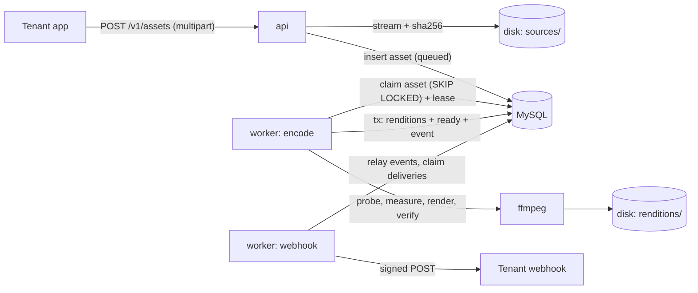
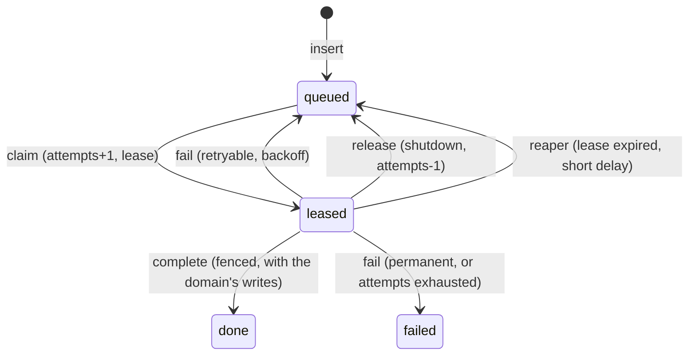

# SlumberMill: Multi-tenant Audio Ingest Pipeline

**Project spec** · Go 1.27 · Gin 1.12 · GORM 1.31 · MySQL 8 · ffmpeg 6.1 · runs entirely in Docker

Measured figures come from a prototype run with Go 1.27.2, Gin 1.12.0, MySQL driver 1.10.1,
MySQL 8.0.46 (default 128 MB buffer pool) and Ubuntu 24.04's ffmpeg 6.1.1 on 2 CPU cores.
Leasing, the outbox and the relay (§6, §8) were measured with GORM 1.31.2 on exactly the schema in §5,
and the GORM rules in §3 come from a separate GORM probe.
Items marked *(known trap)* come from documentation or established practice.
Container behaviour was verified with a Linux PID namespace, the kernel mechanism Docker uses.

---

## 1. Summary

SlumberMill is a small Go service that takes an uploaded sleep story or soundscape,
loudness-normalises it to the tenant's target, encodes streaming and offline renditions, verifies every one of them,
and notifies the tenant by signed webhook.

The scope is deliberately narrow: one upload path, two renditions, two event types.
The depth goes into the parts that fail in production: concurrency on MySQL, tenant isolation, webhook delivery,
process lifecycle and shutdown, and loudness that is verified rather than assumed.

## 2. Non-goals

- No admin UI. Tenants are created with a CLI command.
- No object storage or CDN. Local disk sits behind a small storage type; the README explains the production swap.
- No push notifications or payment webhooks. Both are listed as next steps (§17).
- No metrics stack. Structured logs only; metrics are listed as a next step.
- No per-tenant fairness scheduling. Called out as a known limitation.

## 3. Stack

| | Choice | Notes |
|---|---|---|
| Language | Go 1.27 (`go 1.27.0` in `go.mod`) | See "Using Go 1.27" |
| HTTP | Gin v1.12.0 | Needs Go 1.25+; mind its dependency footprint (pitfall 4) |
| Data access | GORM v1.31, `gorm.io/driver/mysql` v1.6 | On `go-sql-driver/mysql` v1.10; rules below |
| Database | MySQL 8.4 (8.0.1+ works) | Leasing needs `SKIP LOCKED` |
| Media | ffmpeg 6.1.1 from Ubuntu 24.04 | Fixed by the encode worker's image; the figures depend on it |
| Runtime | Docker with Compose v2 | The only thing the host needs (§12) |
| CI | GitHub Actions | Runs the same Compose `dev` service as a laptop |

No other dependencies.

### Using Go 1.27

- **`uuid` [1.27]:** `uuid.NewV7()` for public and event IDs (§5).
- **Container-aware `GOMAXPROCS` [1.25]:** size the encode pool with `runtime.GOMAXPROCS(0)`,
  which follows the container's CPU limit. `runtime.NumCPU()` reports the host's cores,
  so a container limited to 2 CPUs on a 32-core host would start 32 ffmpeg processes.
- **`sync.WaitGroup.Go` [1.25]** and **`errors.AsType` [1.26]**.
- **`testing/synctest` [1.25], with `synctest.Sleep` and `httptest.NewTestServer` [1.27],** for heartbeat, grace-period
  and timeout logic on a fake clock. Anything touching MySQL stays on real time, because leases use the database clock.
- **Goroutine leak profile [1.27]:** serve `/debug/pprof/goroutineleak` on an internal-only port.

### Data access: GORM

GORM stays in the repository layer (§4).
Its defaults suit CRUD but clash with leased work, so repositories follow these rules:

```go
db, err := gorm.Open(mysql.Open(dsn), &gorm.Config{
    SkipDefaultTransaction: true,               // transactions only where a repository opens one
    TranslateError:         true,               // MySQL 1062 → gorm.ErrDuplicatedKey (pitfall 8)
    Logger:                 newGormLogger(log), // slog-backed; IgnoreRecordNotFoundError
})
```

- **Every call carries the caller's context** (`r.db.WithContext(ctx)`);
  without it GORM runs on `context.Background()` and nothing is cancelled.
- **Timestamps belong to MySQL:** tag `CreatedAt` and `UpdatedAt` `gorm:"->"` (pitfall 6).
- **Updates use maps**, with `gorm.Expr` for arithmetic and `NOW(6)`; never structs or `Save` (pitfall 7).
- **Fences check `RowsAffected`**, which needs `clientFoundRows=true` (pitfall 12).
- **Single-row reads use `Take`** and check `gorm.ErrRecordNotFound`; `Find` never returns it.
- **Upserts** use `clause.OnConflict`.
- **Public IDs** use a `db.ID` wrapper around `uuid.UUID` (pitfall 5),
  and **`warnings`** a small type that splits and joins the `SET`'s comma-separated form
  (MySQL returns members in definition order); both in repository models only.
- **A page's renditions** come from one `Preload` with a tenant filter, not one query per asset.
- **No `AutoMigrate`** (§11).

## 4. Architecture

One binary with four subcommands, run as separate containers so the API
and each worker pool scale and restart independently.

```
slumber-mill migrate                 apply database migrations
slumber-mill api                     serve the HTTP API
slumber-mill worker -pool P          run a worker pool: encode or webhook
slumber-mill tenant create -slug S [-webhook-url U] [-target-lufs F]
```



### Domains and transactions

Each domain package owns its tables, and every transaction stays inside one repository:

| Package | Owns | Writes |
|---|---|---|
| `tenant` | `tenants` | One insert per tenant |
| `asset` | `assets`, `renditions`, `asset_events` | Upload: one insert. Finish or fail: one transaction |
| `webhook` | `webhook_deliveries` | One transaction per step: create, claim, complete, retry |

- **The asset is its own unit of work.** Its `status` (queued, processing, ready, failed) is the lease state,
  and the lease columns sit on the same row (§6). An upload is one insert;
  finishing or giving up is one transaction in the asset repository. The status the API shows is always the truth:
  `queued` while a retry waits, `processing` while a worker holds the lease.
- **Effects on other domains go through an outbox.**
  Finishing or failing an asset writes an `asset_events` row in that same transaction.
  The webhook pool's relay reads unrelayed events through `asset.Service`, inserts one delivery per event
  (the event ID is unique, so a repeat is a no-op) and then marks the events relayed (§8).
  Those are two single-repository writes, and a crash between them only repeats the no-op.
- **No service opens a transaction.** Transactions are a detail inside repository methods, so no transaction handle,
  `*gorm.DB` or transaction-carrying context exists above the repositories.
- **Reads across domains are service calls:** the relay reads assets through `asset.Service`,
  and delivery reads the tenant's URL and secret through `tenant.Service`.

### Repository layout

```
src/                         the Go module: go.mod, go.sum and all Go code
  cmd/slumber-mill/main.go   composition root: env config, wiring, subcommands, signal handling
  db/                        Open (GORM config), lease SQL, Migrate (embedded SQL), ID, Clip, GORM logger
  db/migrations/             0001_init.sql
  worker/                    pool runtime: polling, heartbeats, grace, release, backoff, panics
  tenant/                    repository.go, service.go (create, authenticate, webhook target)
  asset/                     repository.go, service.go (upload, get, list, renditions, events), processor.go
  webhook/                   repository.go, service.go (relay, deliver), sign.go (Sign, Verify), client.go
  egress/                    IsPublic, ErrBlockedAddress, HostChecker: which addresses outbound calls may reach
  audio/                     ffprobe/ffmpeg wrappers, loudness report parsing
  storage/                   local disk with atomic promote, temp sweep
  secret/                    random tokens (sm_, whsec_), AES-GCM box for stored secrets, redacting Value type
  apiv1/                     public JSON types, shared by API responses and webhook payloads
  validation/                field errors that services return and the API renders as 400
  logging/                   a logger carried in the context (CtxWithLogger, LoggerFromContext)
  httpsrv/                   Gin router, middleware, handlers, error mapping
  testutil/                  throwaway MySQL database per test, audio fixtures
var/                         host-synced volumes; gitignored apart from the .gitkeep files
  data/                      uploads and renditions, mounted at /data (§10)
  out/                       test and tool output for the host, such as coverage profiles
Dockerfile                   base, dev, build and runtime stages (§12)
compose.yaml                 MySQL, migrate, api, two worker pools, dev (§12)
.github/workflows/ci.yml     builds the images and runs the tests in the dev service
README.md
```

- **`src/` is the Go module:** `module github.com/zanvd/slumber-mill/src`.
  A module in a subdirectory needs its path to end in that directory to stay resolvable,
  and Go commands run from `src/`, the `dev` container's working directory.
- **No `internal/`.** It stops other modules importing a package, and nobody imports an application.
- **Nothing the containers write lands in `src/`.**
  Host-synced volumes live under `var/` (the `.gitkeep` files make git create them owned by whoever cloned),
  MySQL's data and the Go caches live in named volumes, and the Dockerfile copies only `src/`.

### Layers

Every request and every job passes through three layers: transport, service and repository, with adapters for ffmpeg,
disk and outbound HTTP beside the repositories. Each layer reaches the one below only through interfaces,
and nothing specific to one layer's technology crosses into another:

| Layer | Lives in | Never sees |
|---|---|---|
| Transport | `httpsrv/` (Gin) and the CLI in `main.go` | GORM, SQL, ffmpeg, file paths |
| Service | `service.go`, `processor.go`, `worker/` | Gin, `*http.Request`, GORM, driver errors |
| Repository | `repository.go` in each domain package, and `db/` (GORM) | Gin, services, other packages' tables |
| Adapters | `audio/` (ffmpeg), `storage/` (disk), `webhook/client.go` (outbound HTTP) | Gin, services |

- **Wiring happens in `main.go` and nowhere else.** Constructors take interfaces and return concrete types,
  such as `asset.NewService(repo, files)` and `httpsrv.NewServer(log, tenants, assets, cfg)`.
  No package-level state, no wiring in `init`.
- **Interfaces belong to their consumer.** Each is declared, unexported, in the package that uses it,
  with only the methods it calls: `asset/service.go` declares `repo` and `fileStore`,
  and `httpsrv` declares `assetService` and `tenantService`. Unit tests replace each one with a fake.
- **Repositories are private to their package.**
  Their methods are unexported, so any other package goes through that package's service.
  GORM models are unexported structs converted to and from domain types at the boundary (`toRepo`, `newAssetFromRepo`),
  so GORM tags and `db.ID` never appear in a domain type.
- **A plain `context.Context` crosses layers, never `*gin.Context`** (pitfall 1).
  It carries cancellation and the request's or job's logger (`logging.LoggerFromContext`).
- **Errors are translated at each boundary.**
  A repository maps `gorm.ErrRecordNotFound` to its package's `ErrNotFound` and `gorm.ErrDuplicatedKey`
  to an unexported `errDuplicate`, and wraps anything else as `fmt.Errorf("error ...: %w: %v", errDatabase, err)`,
  so GORM and driver errors are out of reach of `errors.Is` and `errors.As` above it.
  Services return domain errors (`asset.ErrNotFound`, `asset.ErrIdempotencyKeyReused`, `*validation.Error`),
  and `httpsrv` maps them to status codes in one function.
- **Each boundary has its own types.** Handlers turn requests into service parameter structs;
  responses and webhook payloads use the `apiv1` types, built from domain types by `apiv1.NewAsset`.
- **The API never builds the processor.** `asset.Service` and `asset.Processor` share the package's repository,
  but only the processor depends on `audio`, and only the encode pool constructs one (§12).

## 5. Data model

```sql
-- API keys are high-entropy random tokens, so plain SHA-256 is enough.
-- Webhook secrets can't be hashed, because signing needs the secret itself,
-- so they're encrypted (§8).
CREATE TABLE tenants (
    id                 BIGINT UNSIGNED NOT NULL AUTO_INCREMENT,
    slug               VARCHAR(64)  CHARACTER SET ascii COLLATE ascii_bin NOT NULL,  -- immutable
    api_key_hash       BINARY(32)      NOT NULL,
    webhook_url        VARCHAR(2048)   NULL,
    webhook_secret_enc VARBINARY(128)  NULL,  -- key ID, nonce, AES-256-GCM ciphertext and tag
    target_lufs        DECIMAL(4, 1)   NOT NULL DEFAULT -16.0,
    created_at         DATETIME(6)     NOT NULL DEFAULT CURRENT_TIMESTAMP(6),
    PRIMARY KEY (id),
    UNIQUE KEY uq_tenants_slug (slug),
    UNIQUE KEY uq_tenants_api_key_hash (api_key_hash)
) ENGINE = InnoDB DEFAULT CHARSET = utf8mb4 COLLATE = utf8mb4_0900_ai_ci;

-- An asset is also its own unit of work: status is the lease state (§6).
CREATE TABLE assets (
    id                   BIGINT UNSIGNED NOT NULL AUTO_INCREMENT,
    public_id            BINARY(16)      NOT NULL,       -- UUIDv7
    tenant_id            BIGINT UNSIGNED NOT NULL,
    -- Compared byte for byte: under utf8mb4_0900_ai_ci 'AbC' = 'abc' and 'straße' = 'strasse'.
    idempotency_key      VARCHAR(255) CHARACTER SET ascii COLLATE ascii_bin NULL,
    title                VARCHAR(255)    NOT NULL,
    status               ENUM ('queued','processing','ready','failed') NOT NULL DEFAULT 'queued',
    attempts             SMALLINT UNSIGNED NOT NULL DEFAULT 0,       -- also the fencing token
    run_after            DATETIME(6)     NOT NULL DEFAULT CURRENT_TIMESTAMP(6),
    locked_by            VARCHAR(128)    NULL,
    lease_expires_at     DATETIME(6)     NULL,
    source_sha256        BINARY(32)      NOT NULL,
    source_bytes         BIGINT UNSIGNED NOT NULL,
    source_codec         VARCHAR(32)     NULL,
    duration_ms          BIGINT UNSIGNED NULL,
    target_lufs          DECIMAL(4, 1)   NOT NULL,       -- snapshot of the tenant's target at upload
    input_lufs           DECIMAL(5, 2)   NULL,
    input_true_peak_dbtp DECIMAL(5, 2)   NULL,
    input_lra_lu         DECIMAL(5, 2)   NULL,
    input_max_momentary  DECIMAL(5, 2)   NULL,           -- for the sudden-loud-event warning
    warnings             SET ('sudden_loud_event','dynamic_normalization','source_may_clip') NOT NULL DEFAULT '',
    error                VARCHAR(1024)   NULL,           -- tenant-safe message when failed
    last_error           VARCHAR(2048)   NULL,           -- internal detail, never in the API
    created_at           DATETIME(6)     NOT NULL DEFAULT CURRENT_TIMESTAMP(6),
    updated_at           DATETIME(6)     NOT NULL DEFAULT CURRENT_TIMESTAMP(6) ON UPDATE CURRENT_TIMESTAMP(6),
    PRIMARY KEY (id),
    UNIQUE KEY uq_assets_public_id (public_id),
    UNIQUE KEY uq_assets_tenant_idempotency (tenant_id, idempotency_key),  -- NULLs don't collide
    KEY ix_assets_tenant_id (tenant_id, id),                                -- keyset pagination
    KEY ix_assets_claim (status, run_after),
    KEY ix_assets_lease (status, lease_expires_at),                         -- reaper
    CONSTRAINT fk_assets_tenant FOREIGN KEY (tenant_id) REFERENCES tenants (id)
) ENGINE = InnoDB DEFAULT CHARSET = utf8mb4 COLLATE = utf8mb4_0900_ai_ci;

-- Loudness is measured per rendition: a mono downmix of the same master can
-- differ from the stereo version by about 3 LU (§7).
CREATE TABLE renditions (
    id              BIGINT UNSIGNED  NOT NULL AUTO_INCREMENT,
    tenant_id       BIGINT UNSIGNED  NOT NULL,
    asset_id        BIGINT UNSIGNED  NOT NULL,
    profile         ENUM ('aac_128k','aac_64k') NOT NULL,
    codec           ENUM ('aac')     NOT NULL,
    bitrate_kbps    INT UNSIGNED     NOT NULL,
    channels        TINYINT UNSIGNED NOT NULL,
    bytes           BIGINT UNSIGNED  NOT NULL,
    sha256          BINARY(32)       NOT NULL,
    lufs            DECIMAL(5, 2)    NOT NULL,
    true_peak_dbtp  DECIMAL(5, 2)    NOT NULL,
    lra_lu          DECIMAL(5, 2)    NOT NULL,
    normalization   ENUM ('linear', 'dynamic') NOT NULL,  -- loudnorm can fall back silently (§7)
    created_at      DATETIME(6)      NOT NULL DEFAULT CURRENT_TIMESTAMP(6),
    PRIMARY KEY (id),
    UNIQUE KEY uq_renditions_asset_profile (asset_id, profile),  -- retries upsert, never duplicate
    KEY ix_renditions_tenant (tenant_id),
    CONSTRAINT fk_renditions_asset FOREIGN KEY (asset_id) REFERENCES assets (id) ON DELETE CASCADE
) ENGINE = InnoDB DEFAULT CHARSET = utf8mb4 COLLATE = utf8mb4_0900_ai_ci;

-- The outbox: written in the same transaction as the asset change it records,
-- read and acknowledged by the webhook relay (§8).
CREATE TABLE asset_events (
    id          BIGINT UNSIGNED NOT NULL AUTO_INCREMENT,
    event_id    BINARY(16)      NOT NULL,       -- UUIDv7; becomes the webhook's event ID
    tenant_id   BIGINT UNSIGNED NOT NULL,
    asset_id    BIGINT UNSIGNED NOT NULL,
    type        ENUM ('asset.ready','asset.failed') NOT NULL,
    created_at  DATETIME(6)     NOT NULL DEFAULT CURRENT_TIMESTAMP(6),
    relayed_at  DATETIME(6)     NULL,
    PRIMARY KEY (id),
    UNIQUE KEY uq_asset_events_event_id (event_id),
    KEY ix_asset_events_pending (relayed_at, id),
    CONSTRAINT fk_asset_events_asset FOREIGN KEY (asset_id) REFERENCES assets (id) ON DELETE CASCADE
) ENGINE = InnoDB DEFAULT CHARSET = utf8mb4 COLLATE = utf8mb4_0900_ai_ci;

CREATE TABLE webhook_deliveries (
    id               BIGINT UNSIGNED   NOT NULL AUTO_INCREMENT,
    event_id         BINARY(16)        NOT NULL,   -- one delivery per event, however often it's relayed
    tenant_id        BIGINT UNSIGNED   NOT NULL,
    body             MEDIUMBLOB        NOT NULL,   -- the exact bytes that get signed
    state            ENUM ('queued','sending','delivered','failed') NOT NULL DEFAULT 'queued',
    attempts         SMALLINT UNSIGNED NOT NULL DEFAULT 0,   -- also the fencing token
    run_after        DATETIME(6)       NOT NULL DEFAULT CURRENT_TIMESTAMP(6),
    locked_by        VARCHAR(128)      NULL,
    lease_expires_at DATETIME(6)       NULL,
    last_error       VARCHAR(2048)     NULL,
    created_at       DATETIME(6)       NOT NULL DEFAULT CURRENT_TIMESTAMP(6),
    updated_at       DATETIME(6)       NOT NULL DEFAULT CURRENT_TIMESTAMP(6) ON UPDATE CURRENT_TIMESTAMP(6),
    PRIMARY KEY (id),
    UNIQUE KEY uq_webhook_deliveries_event_id (event_id),
    KEY ix_webhook_deliveries_claim (state, run_after),
    KEY ix_webhook_deliveries_lease (state, lease_expires_at)
) ENGINE = InnoDB DEFAULT CHARSET = utf8mb4 COLLATE = utf8mb4_0900_ai_ci;
```

- **Every tenant-owned query filters on `tenant_id`**, and every index the API uses leads with it.
- **Public and event IDs are UUIDv7** in `BINARY(16)`, shown in canonical lowercase; `uuid.Parse` accepts either case.
  The `BIGINT` key stays internal: InnoDB copies the primary key into every secondary index, so 8 bytes beat 16.
  Version 7 keeps inserts append-mostly, at the cost of revealing creation time, which the API returns anyway.
- **Secrets aren't UUIDs.** API keys are `sm_` plus 160 random bits and webhook secrets `whsec_` plus 192, both base32;
  the prefixes make leaks easy to spot. The database holds only the key's hash and the secret's ciphertext.
- **Collations are right in migration 0001** (pitfall 10): identifiers that must compare byte for byte use `ascii_bin`,
  and the API accepts only printable ASCII in `Idempotency-Key`.
  `ascii_bin` ignores trailing spaces (PAD SPACE), so `'x '` equals `'x'`, and validation rejects leading and trailing
  spaces in slugs and `Idempotency-Key` values.
- **Tenant fields are validated before the insert.** A slug is 1–64 lower-case ASCII letters, digits and hyphens,
  starting and ending with a letter or digit, which also keeps `/` out of the webhook secret's AAD (§8).
  A webhook URL is optional: at most 2048 bytes of printable ASCII without spaces,
  an absolute `http` or `https` URL with a host, and without userinfo, which would sit in the row in plaintext,
  or a fragment.
  `target_lufs` is finite and from −70 to −5 LUFS, loudnorm's range, and is rounded to one decimal place
  before the insert, so the tenant `tenant create` returns matches the row.
- **Closed sets are `ENUM` or `SET`:** `status`, `state`, `type`, `profile`, `codec`, `normalization` and `warnings`.
  In strict mode, MySQL 8's default, a value outside the list fails the insert (error 1265),
  so a typo in code can't be stored. New members are only ever appended, which is instant;
  inserting one mid-list, or growing a `SET` past 8 members, rebuilds the table (§11).
- **The DSN is normalised in code:** `ParseTime=true`, `Loc=UTC`,
  session `time_zone='+00:00'` and `clientFoundRows=true` are forced, and `interpolateParams=true` is refused,
  so parameters always travel separately from the SQL.

## 6. Leased work

Two tables hold work: `assets` for the encode pool and `webhook_deliveries` for the webhook pool.
Both follow one lease protocol, written once as SQL helpers in `db` (parameterised by table and state names)
and driven by the runtime in `worker`. The README explains why not Redis or SQS:
one fewer system to operate, and work is created in the same insert or transaction as the data it belongs to.



`leased` and `done` are `processing` and `ready` for assets, and `sending` and `delivered` for deliveries.

```sql
SELECT id, tenant_id, attempts FROM <table>
WHERE <state> = 'queued' AND run_after <= NOW(6)
ORDER BY run_after, id
LIMIT 1
FOR UPDATE SKIP LOCKED
```

- **Claim** runs the query above in a **READ COMMITTED** transaction, then sets the leased state,
  `attempts + 1`, `locked_by` and `lease_expires_at = NOW(6) + lease`.
  In GORM the lock comes from `clause.Locking` with `clause.LockingOptionsSkipLocked`.
  Uploads insert into the table the encode pool claims from, and under REPEATABLE READ the claim's gap locks cost them
  a third of their throughput and tripled their p99 latency (pitfall 11).
- **Fencing:** every write after a claim matches `id`, the leased state and `attempts`.
  Zero rows affected means `ErrLeaseLost`, and the holder discards its result (pitfall 12).
- **Heartbeat** every `lease / 3`, fenced. `ErrLeaseLost` cancels the work's context, which kills ffmpeg;
  a single failed beat is only logged.
- **Complete:** the fenced state change and the domain's writes in one repository transaction.
  For an asset that's renditions, measurements, `ready` and an `asset.ready` event; for a delivery, just `delivered`.
- **Fail:** a permanent error, or the last attempt, sets `failed`;
  an asset also gets its tenant-safe message and an `asset.failed` event in the same transaction.
  Otherwise the row goes back to `queued` with `run_after = NOW(6) + backoff`:
  exponential with equal jitter, a random value in `[d/2, d]` where `d = min(base·2^(attempt-1), max)`.
- **Release** on shutdown: back to `queued` with `attempts - 1`, so deploys don't use up retries.
- **Reaper:** rows whose lease expired, `FOR UPDATE SKIP LOCKED`, 100 at a time. It counts as an attempt,
  so work that keeps killing workers eventually fails, but it requeues with a short fixed delay (about 5 s),
  not the backoff (pitfall 26). Running out of attempts fails the row as above. Each pool reaps only its own table.
- **Clock:** every time comes from `NOW(6)`, so clock skew between hosts can't distort leases.
- **Retention:** delete delivered deliveries 30 days after delivery (`updated_at`)
  and relayed events 30 days after relay (`relayed_at`), in small keyset batches.
- **Finished rows stay cheap.** Assets are never deleted, so finished rows pile up.
  With 1,048,576 finished rows in each of `assets`, `asset_events` and `webhook_deliveries`
  (926 MB, far beyond the buffer pool), every hot query stayed an index range scan over the unfinished rows:
  a claim read one row and took about 2 ms with its commit, as on empty tables,
  the reaper scan 0.6 ms and the relay's read 0.9 ms.
- **Verified** in 22 soak runs of 15 s on this schema, with 8 uploaders, 32 encode workers on 150 ms leases
  (so leases expire constantly), 2 reapers, and in 10 of them the relay and 8 delivery workers:
  up to about 4,600 completions and 235 stale completions fenced out in a run,
  no deadlocks or lock-wait timeouts, and every invariant in §13 held.

### Worker runtime

```go
type source interface {
    Claim(ctx context.Context) (Lease, bool, error)       // false: nothing is due
    Extend(ctx context.Context, l Lease) error            // heartbeat; ErrLeaseLost when fenced out
    Process(ctx context.Context, l Lease) error           // does the work, then completes it, fenced
    Fail(ctx context.Context, l Lease, cause error) error // retry with backoff, or give up
    Release(ctx context.Context, l Lease) error
    Reap(ctx context.Context) error
}

type Lease struct {
    ID, TenantID uint64
    Attempt      int
}

func Permanent(err error) error // wrap errors that retrying can't fix
```

- **Separate pools** (pitfall 27): `worker -pool encode` and `worker -pool webhook` are separate Compose services.
  Encoding gets one slot per available CPU (`runtime.GOMAXPROCS(0)`),
  since loudnorm and the AAC encoder are effectively single-threaded per job; webhooks get more, being I/O-bound.
- Idle slots poll with jitter (0.5–1.5×), so a fleet doesn't hit MySQL in lockstep.
- **Shutdown** stops claiming at once. In-flight work runs on a context derived
  from `context.WithoutCancel(ctx)` and gets `Grace` to finish; then its context is cancelled and it's released.
  Work that fails while the pool is draining is also released, not failed (pitfall 24).
- **Outcome order:** lease lost → discard; success → done; cancelled or draining → release; otherwise → fail.
  Outcomes are written on a fresh 15 s context.
  `Process` runs its completion on `context.WithoutCancel(ctx)` with the same 15 s timeout: a heartbeat that finds
  the row already finished cancels the work's context, and the driver could then report a committed autocommit
  completion as cancelled.
- **Panics** become a failed attempt, not a dead worker.
- **On startup, sweep `tmp/`** of files older than the lease (pitfall 25). The processor refreshes its temp files'
  modification time every `lease / 3` while it holds them, so only a dead attempt's files age past the lease.
- The pool puts a logger carrying `worker`, `pool`, `id`, `tenant_id`, `attempt` and `took` into the work's context.
- `RunUntilIdle(ctx)` processes until nothing is due, for tests.

## 7. Audio processing (encode pool)

Three attempts, backoff from 30 s to 10 min, a 3 h timeout.
Budget about 140 s per 10 minutes of audio, even with two encodes sharing two cores,
roughly 2.3 hours for a 10-hour soundscape (pitfall 23),
and size the timeout, the lease and the pool's CPU limit with that in mind.

### Steps

1. **Claim** the asset (§6).
2. **Probe** the source, with the input whitelists from "ffmpeg execution":
   `ffprobe -v error -select_streams a:0 -show_entries stream=codec_name,sample_rate,channels:format=duration -of json`.
   A missing file is retryable (a storage blip). A file ffprobe can't parse or may not open, or with no audio stream,
   is a **rejection** ("not audio"); so is anything **shorter than 3 s** ("too short", pitfall 20).
3. **Measure each output layout (pass 1).** For every distinct channel layout among the profiles,
   measure the downmixed signal: `-af aformat=channel_layouts=<layout>,loudnorm=...:print_format=json` (pitfall 15).
   Run `ebur128` once for max momentary loudness. Integrated `-inf` or below −70 LUFS is a **rejection** ("silent").
4. **Predict linear or dynamic.** Linear gain is only possible if `measured_TP + (target − measured_I) ≤ TP`
   and `measured_LRA ≤ LRA`, where `TP` is the pre-encode true peak passed to loudnorm (not the published ceiling)
   and `LRA` is loudnorm's; otherwise loudnorm silently switches to dynamic mode (pitfall 18).
   loudnorm reads a measured LRA of 0 as unmeasured, so pass `max(measured_LRA, 0.01)`.
   Render anyway, but record `normalization='dynamic'` and warn.
5. **Render (pass 2):** one ffmpeg run, one loudnorm per layout with its own measurements,
   and pass 1's `target_offset` as `offset` (command below).
   Run it at `-loglevel info`, since the pass-2 report only prints at that level,
   and **check the exit status before parsing any report** (pitfall 21).
6. **Verify every rendition** (pitfall 16): integrated loudness within ±1 LU of target and true peak
   at or below the published ceiling. Store each rendition's `lufs`, `true_peak_dbtp`, `lra_lu` and `normalization`;
   a failed check is a **rejection** with the numbers.
7. **Hash and promote** each output to `renditions/<tenant>/<asset>/<profile>.m4a` (§10).
8. **Complete** (§6): renditions, measurements, warnings, `ready` and the `asset.ready` event, in one transaction.

The pass-2 command from step 5 (line breaks added for readability):

```
-filter_complex "
  [0:a:0]asplit=2[s][m];
  [s]aformat=channel_layouts=stereo,
     loudnorm=I=..:TP=..:LRA=..:measured_*=<stereo>:offset=<stereo>:linear=true:print_format=json,
     aresample=48000[o0];
  [m]aformat=channel_layouts=mono,
     loudnorm=I=..:TP=..:LRA=..:measured_*=<mono>:offset=<mono>:linear=true:print_format=json,
     aresample=48000[o1]"
-map [o0] -map_metadata -1 -c:a aac -b:a 128k -cutoff 20000 -movflags +faststart -f mp4 tmp0
-map [o1] -map_metadata -1 -c:a aac -b:a 64k                -movflags +faststart -f mp4 tmp1
```

### Profiles

| Profile | Bitrate | Channels | Purpose |
|---|---|---|---|
| `aac_128k` | 128 kbps | `min(source, 2)` | Streaming; keeps stereo soundscapes stereo |
| `aac_64k` | 64 kbps | 1 | Offline downloads on small or full phones |

Both outputs are 48 kHz MP4/AAC with `+faststart`.
The integrated target comes from the tenant (default −16 LUFS) and is snapshotted onto the asset at upload.
The published ceiling is −1.5 dBTP. loudnorm gets a pre-encode `TP` of −4.0 dBTP, 2.5 dB of headroom below it,
because the encoder adds true peak (pitfall 17), and `LRA=50`, its maximum in 6.1.1:
it never blocks linear mode, and lower values pull dynamic renders off target.

### Why per-rendition loudness (measured)

| Source (normalised to −16 LUFS, lossless) | AAC 128k stereo | AAC 64k mono |
|---|---|---|
| Pink noise, uncorrelated stereo (real field recording) | −16.03 | **−18.75** |
| White noise, uncorrelated stereo | −16.50 | **−19.39** |
| White noise, dual-mono | **−17.01** | −16.39 |
| White noise, dual-mono, `-cutoff 20000` | −16.36 | −16.39 |
| Pink noise, dual-mono (most narration) | −16.39 | −15.76, **−0.14 dBTP** |

Uncorrelated stereo loses about 3 LU in the mono downmix,
correlated content gains 3 dB of peak, and the encoder shifts both loudness and peak.
Loudness and the peak ceiling are therefore **verified properties of each encoded file**, not settings on the input.

### Warnings (publishable, but worth a human ear)

- `sudden_loud_event`: max momentary loudness more than **10 LU** above integrated (pitfall 19).
- `dynamic_normalization`: linear gain was impossible (step 4).
- `source_may_clip`: input true peak above −0.5 dBTP.

### Rejections, errors and side effects

- **A rejection is permanent** and carries a message that is **safe to show the tenant**;
  failing stores it in `assets.error`. Any other cause becomes "processing failed after repeated attempts".
  ffmpeg's stderr, which contains internal paths, stays in logs and `last_error`.
- **Outputs are deterministic and promoted by atomic rename**, so if an attempt loses its lease after promoting,
  the files it left are identical to what the winner writes.
- **Loops:** AAC in MP4 isn't sample-accurate (pitfall 22), so seamless soundscapes can click at every seam
  unless players honour gapless metadata or crossfade. The README flags it for the players; solving it is out of scope.

### ffmpeg execution

- At startup the encode pool runs `ffmpeg -version` and `ffprobe -version`, logs the build,
  and exits with a clear error if either is missing.
- The processor reaches `audio` through a `transcoder` interface it declares,
  and `audio` runs commands through a runner interface, so unit tests can fake either.
- `exec.CommandContext` with `cmd.WaitDelay = 5s`. On failure, return the last 3 lines of stderr;
  if the context was cancelled, return `ctx.Err()`.
- **Input whitelists:** every run that reads a source or a rendition passes
  `-protocol_whitelist file -format_whitelist wav,mp3,flac,ogg,mov,aac,matroska,aiff` before its input
  (after it, ffmpeg ignores them). Otherwise an uploaded HLS or concat playlist is followed into other local files,
  publishing their audio as the upload's, and URLs are fetched.
  An mp4 or mov track kept in another file through a `dref` reference stays unopened only because the mov demuxer's
  `enable_drefs` defaults to off; it can't be pinned off, since ffmpeg fails other inputs, such as WAV,
  with "Option enable_drefs not found". `TestProcessIgnoresExternalTracks` guards that default.
- **`SysProcAttr{Setpgid: true}`**, so a terminal Ctrl-C reaches only the worker,
  which drains first and cancels later (pitfall 24).
- No parent-death signal is needed in containers: however the worker exits,
  the kernel kills the rest of the container with it (§12).

## 8. Webhooks (webhook pool)

The webhook pool runs two loops: the relay, which turns asset events into deliveries, and the delivery slots (§6).

### Relay

- **One relay at a time** (pitfall 33). Every webhook worker tries `GET_LOCK` on `slumber-mill.relay.` followed
  by a hash of the database name, with timeout 0, on a dedicated connection once a second, and only the holder
  relays. A crash ends its session, which frees the lock;
  on shutdown it calls `RELEASE_LOCK` before closing the connection (pitfall 13).
  Measured: another worker took over within 0.7 s.
- **Drain, then wait** (pitfall 32). Read unrelayed events through `asset.Service` in batches of 100, oldest first,
  back to back until a batch comes back short; then wait a second. Filtering on `relayed_at IS NULL` rather
  than keeping a cursor means an event whose transaction committed late is still picked up.
- For each event whose tenant has a `webhook_url`, insert a delivery keyed by the event ID; a repeat is a no-op.
  Events of a tenant without a URL are only marked relayed. The body is built at relay time from the asset,
  which is final once `ready` or `failed`, so it matches the event.
- Then mark the batch relayed. A crash in between repeats the inserts, which change nothing.
- **Measured lag** from an event's creation to its relay:
  about 0.6 s on average and 1.2 s at p99 with 135–175 completions a second, and 1.8 s at worst across a failover.

### Delivery

- **Event:** `{"id":"<uuid>","type":"asset.ready|asset.failed","created_at":"...","data":<asset>}`,
  where `id` is the event's UUIDv7 and `data` is `apiv1.NewAsset(a)`, the API's own shape.
  The stored body is the exact bytes that get signed.
- **Request:** POST with `Content-Type: application/json`, `User-Agent: slumber-mill-webhooks/1`, `SlumberMill-Event-Id`
  and `SlumberMill-Signature`. The URL and secret come from `tenant.Service.WebhookTarget` **at delivery time**,
  so fixing an endpoint or rotating a secret applies to pending retries.
- **Outcomes:** 2xx → delivered; **410 Gone → permanent**; anything else, including 3xx, → retry.
  Drain at most 64 KiB of the response for keep-alive.
  After the body is closed, Go's transport may itself read up to 256 KiB more, for at most 50 ms.
- **Retries:** 12 attempts, backoff from 30 s doubling to a 6 h cap, roughly 7–15 hours in total.
- **Signature:** `t=<unix>,v1=<hex HMAC-SHA256(secret, "<t>.<body>")>`, in the style Stripe uses.
  Export `Verify(secret, header, body, now, tolerance)` for receivers: it accepts several `v1` values (for rotation),
  compares with `hmac.Equal`, and rejects timestamps outside the tolerance.
- **Semantics:** at-least-once and unordered. Receivers dedupe on the event ID.

### Webhook secrets at rest

Every delivery computes an HMAC with the secret itself, so unlike an API key it can't be stored as a hash.
It's encrypted instead, so a database dump,
a backup or a read-only SQL injection doesn't hand out what's needed to forge events.

- **AES-256-GCM** from the standard library, in `secret.Box`. The stored value is a one-byte key ID,
  a 12-byte random nonce, then the ciphertext and its 16-byte tag: 74 bytes for a 45-character `whsec_` secret.
- **Bound to its row.** The additional authenticated data is `tenants/<slug>/webhook_secret`,
  so a ciphertext copied into another tenant's row fails to open.
  Slugs are immutable and known before the insert, so `tenant create` seals first and writes one row.
- **A key ring:** `SLUMBER_MILL_SECRET_KEYS=<id>:<base64 key>[,...]`.
  The first key seals and any listed key opens, so a new key can go first while older ciphertexts still open.
  Re-sealing old rows and then dropping the old key is documented, not built.
- **Only what needs the key gets it:** `tenant create`, which seals, and the webhook pool, which opens.
  Both refuse to start without a valid key ring; there's no plaintext fallback. In Compose the CLI runs
  in the `api` service, so `api` and `worker-webhook` get the key and `worker-encode` and `migrate` don't.
  Compose sets a fixed key marked dev-only; production reads it from a secret manager,
  or unwraps a data key with a KMS at startup.
- **An opened secret is a `secret.Value`**, whose `String` and `LogValue` print `[redacted]`; signing uses its bytes.
- **Not covered:** someone holding both the database and the webhook pool's environment.
  Ed25519 signatures would remove per-tenant secrets altogether, but HMAC is what most receivers already verify,
  so the README lists Ed25519 as an option.

### SSRF-safe client

Tenants supply URLs, so the client must not become a proxy into the private network.
`IsPublic`, `ErrBlockedAddress` and `HostChecker` live in the leaf package `egress`, which `webhook/client.go`'s dialer and `tenant` both use.

- A `net.Dialer.Control` checks the **IP actually being dialled** (after DNS resolution, which defeats rebinding)
  with `IsPublic(netip.Addr)`. It rejects anything that isn't global unicast, private, loopback, link-local,
  multicast and unspecified addresses, IPv4-mapped forms of those, `0.0.0.0/8`, `100.64.0.0/10`, `192.0.0.0/24`,
  `192.88.99.0/24` (6to4 relay anycast), `198.18.0.0/15`, `240.0.0.0/4`, `64:ff9b::/96` and `64:ff9b:1::/48` (NAT64),
  `2001::/23` (IETF protocol assignments), `2002::/16` (6to4), `5f00::/16` (SRv6 SIDs) and `fec0::/10` (site-local).
  A network-specific NAT64 prefix, which each network's operator picks, can embed private IPv4 addresses,
  so no fixed list can cover it.
- `Proxy: nil`, since environment proxies would bypass the check; redirects aren't followed (`http.ErrUseLastResponse`).
- Timeouts: dial 5 s, TLS handshake 5 s, response headers 10 s, overall 15 s, `IdleConnTimeout` 90 s.
- Errors returned by the client show the URL only as `scheme://host[:port]`, since tenant URLs often carry credentials in the path or query.
- `ErrBlockedAddress` is permanent. `SLUMBER_MILL_WEBHOOK_ALLOW_PRIVATE=true` is for local development and tests only.
  `egress.ErrUnresolvable` (the lookup failed, timed out or returned no addresses) is retryable for deliveries,
  since DNS failures are often transient.
- **`tenant create` checks too.** It refuses a webhook URL whose host is an IP literal that isn't public,
  or a name that doesn't resolve or resolves to any address that isn't public, with the field errors
  "host must resolve" and "host must be public", and honours `SLUMBER_MILL_WEBHOOK_ALLOW_PRIVATE`.
  DNS can change after creation, so the dial-time check stays the real guard.

## 9. HTTP API

All `/v1` routes require `Authorization: Bearer sm_...`.
The auth middleware resolves the tenant with `tenant.Service.Authenticate`,
which looks the key up by its SHA-256 hash, so no secret string comparison leaks timing.
Handlers pass the tenant's ID to every service call, and services to every repository query.

- **Pass `c.Request.Context()` to services, never `*gin.Context`** (pitfall 1).
  It satisfies `context.Context`, so the compiler won't object.
- **Set `r.SetTrustedProxies(<load balancer CIDRs>)`** (pitfall 2).
- **Errors:** `{"error": {"code": "not_found", "message": "no such asset"}}`.
  One function maps service errors to statuses and codes
  (`asset.ErrNotFound` → 404 `not_found`; `*validation.Error` → 400 `invalid_request`, with the fields).
  Anything else is logged and returned as `500 internal` with a generic message.

| Method & path | Behaviour |
|---|---|
| `POST /v1/assets` | Multipart `title` + `file`; returns **202**, the asset and a `Location` header |
| `GET /v1/assets/:id` | 404 for missing *and* other tenants' assets (indistinguishable) |
| `GET /v1/assets?limit=&cursor=` | Newest first; `limit` 1–100, default 20; returns `data` and `next_cursor` |
| `GET /v1/assets/:id/renditions/:profile` | Streams the file with Range support |
| `GET /healthz` | Liveness: always 200, no dependencies |
| `GET /readyz` | Readiness: DB ping with a 2 s timeout; **503 as soon as shutdown begins** |

An `:id` that doesn't parse as a UUID gets the same 404 as an unknown one.
Renditions are served with `http.ServeContent` from the `io.ReadSeekCloser` the service opens;
the `ETag` is the rendition's sha256 and `Cache-Control` is `private, max-age=31536000, immutable`.
On the last page, `next_cursor` is `null`.

### Upload handling

- **Limits at the edge:** `http.MaxBytesReader` on the whole body (default 2 GiB) → `413 file_too_large`,
  and an **idle-read deadline**: no overall `ReadTimeout`,
  but every successful read pushes `http.ResponseController(c.Writer).SetReadDeadline(now + 30s)` forward → `408`
  (pitfall 3). Concurrent uploads per tenant are capped with an in-process semaphore
  (`SLUMBER_MILL_MAX_UPLOADS_PER_TENANT`, default 4) → `429`.
- **The service never sees HTTP.** The handler's body wrapper records why reading stopped,
  and the handler checks that record (413 or 408) before mapping the service's error.
- **Streaming:** the handler walks the parts with `r.MultipartReader()`, reads `title` itself,
  and passes the `file` part to `asset.Service.Stage(ctx, r)`, which streams it to a temp file while hashing;
  nothing is buffered in memory. `Service.Create` then takes the tenant ID, title, idempotency key and staged upload.
  A handler that fails before calling it discards the staged file.
- **Validation:** exactly one file part (the handler); a non-empty file and a title that is present,
  valid UTF-8 and at most 255 characters (the service). The service first trims the title's surrounding
  whitespace, so a whitespace-only title counts as missing and the limit counts the trimmed title.
- **Order of operations:** promote the file to `sources/<tenant>/<asset>` **before** inserting the row,
  so no worker can claim an asset whose source isn't there. If MySQL rejects the insert, delete the file;
  if the outcome is unknown (a timeout or a lost connection), keep it, since an orphan is harmless.
  A crash in between leaves an orphan file (harmless, sweepable), never a row pointing at nothing.
- **One insert** creates the asset as `queued`; there's no separate job to enqueue.
  The response re-reads the row, so it has real timestamps.
- **Production note for the README:** multi-GB uploads on slow links outlast any shutdown grace.
  The production design has clients upload straight to object storage with a presigned URL (or tus),
  and the API only registers the finished object.

### Idempotency-Key

Uploads are long and mobile networks drop. A client that times out can't tell whether the server received the upload,
so it retries, and without a key every retry would create another asset, another encode and another webhook.
The client sends one key per logical upload (a UUID is fine) with every retry of it,
and the server collapses the retries into one asset.

- Optional; printable ASCII, at most 255 bytes, unique per tenant and compared byte for byte (§5),
  so `Upload-42` and `upload-42` are different keys. No key stores NULL, which never collides.
- **Same key, same file hash and title** → replay: 202, the asset in its current state, and `Idempotent-Replayed: true`.
- **Same key, different upload** → `422 idempotency_key_reused`,
  rather than silently returning the old asset and hiding a client bug.
- **Concurrent duplicates:** the unique index guarantees one asset.
  The loser's insert fails (MySQL 1062, which reaches the service as `errDuplicate`);
  it deletes its file, looks up the winner and replays it.
- **Known gap:** the row is written after the file is fully received,
  so a retry during a still-streaming upload sends the bytes twice before losing the race.
  A reservation row at request start answering `409` would close it; out of scope.
- Keys don't expire; they live on the asset row.

### Pagination

Keyset, not OFFSET: `WHERE tenant_id = ? AND id < ? ORDER BY id DESC LIMIT limit+1`,
where the extra row says whether there's another page. The cursor is base64url of the last internal ID,
encoded and decoded by the service and opaque to clients.

## 10. Storage

`storage.Local{root}` is an adapter that services reach through interfaces they declare (§4):

- `TempFile()` → `root/tmp/part-*`, on the same filesystem as the final paths, so `Promote` is an atomic rename.
- `SourcePath(tenantID, assetID)` → `root/sources/<tenant>/<asset>`
- `RenditionPath(tenantID, assetID, profile)` → `root/renditions/<tenant>/<asset>/<profile>.m4a`
- `Promote(tmp, final)` → `MkdirAll` + `os.Rename`
- `SweepTemp(olderThan)`, run at worker and API startup.

In Compose the root is `/data`, bind-mounted from `var/data` and shared by the API and both pools;
uploads and renditions can be played straight from there. The README explains the production version:
object storage, presigned uploads, signed CDN URLs, and the same write-then-commit discipline.

## 11. Migrations

- SQL files embedded with `//go:embed migrations/*.sql`, applied in order,
  recorded in `schema_migrations(version, name, applied_at)`, on a dedicated `database/sql` pool.
- **Safe with many instances starting at once:** `GET_LOCK('slumber-mill.migrate', 60)`,
  with the lock, every migration and `RELEASE_LOCK` on one `*sql.Conn` (pitfall 13).
  Verified: five concurrent `migrate` runs → one applied, four found nothing to do.
- `multiStatements=true` only on the migration pool, never the app's.
- MySQL DDL commits implicitly, so a migration that fails halfway isn't rolled back:
  one logical, re-runnable change per file.
- State `ALGORITHM` and `LOCK` explicitly, so MySQL refuses an unsafe change
  instead of silently falling back to a blocking copy.

### Online DDL on this schema (measured, MySQL 8.0.46)

| Change | Result |
|---|---|
| Add a nullable column | `ALGORITHM=INSTANT` ✓ |
| Append a value to the end of an ENUM | `ALGORITHM=INSTANT` ✓ |
| Insert an ENUM value mid-list | ✗ table rebuild required |
| Append a member to a SET (up to 8 members) | `ALGORITHM=INSTANT` ✓ |
| Grow a SET past 8 members (1 → 2 bytes) | ✗ table rebuild required |
| Add a secondary index | `ALGORITHM=INPLACE, LOCK=NONE` ✓ |
| Change collation of an indexed column (even within utf8mb4) | ✗ `ALGORITHM=COPY` only (blocks writes) |

### README section: zero-downtime migrations (written, not built)

- **Expand → migrate → contract:** add, dual-write, backfill, switch reads, stop writing,
  and drop in a *later* deploy. Never rename in one step.
- **When a change needs a COPY:** build a new column and swap, or use gh-ost or pt-osc;
  watch replica lag and metadata-lock waits, with a low `lock_wait_timeout` on DDL sessions.
- **Backfills** in keyset batches, with sleeps and a replica-lag check between them.
- **Examples:** adding `language` to `assets` (INSTANT); adding a `rejected` status (append, don't insert);
  the idempotency-key collation fix done online.

## 12. Running it: containers and operations

Everything runs in Docker: the service, MySQL, the test suite and CI.
The host needs Docker with Compose v2 and nothing else. An editor that wants `gopls` can attach to the `dev` service,
whose working directory is the module (`/src`).

### Dockerfile

```
base-media     ubuntu:24.04 (pinned by digest) + ffmpeg 6.1.1, version-pinned (see below) + ca-certificates
dev            base-media + Go copied from golang:1.27 + gcc and libc6-dev (cgo, which -race needs) + app user
build          dev with src/ copied in, then CGO_ENABLED=0 go build -trimpath -o /slumber-mill ./cmd/slumber-mill
runtime        gcr.io/distroless/static (pinned by digest) + the binary, USER ${APP_UID}
runtime-media  base-media + the binary + the app user
```

| Image | Used by | Contents |
|---|---|---|
| `runtime` | `api`, `migrate`, `worker-webhook` | The static binary on distroless: CA certificates, tzdata, no shell |
| `runtime-media` | `worker-encode` | The same binary on Ubuntu 24.04, with the pinned ffmpeg and ffprobe |
| `dev` | `dev` | Go, cgo for `-race`, and the same ffmpeg as `runtime-media` |

Both runtime images use `ENTRYPOINT ["slumber-mill"]`,
so `docker compose run --rm api tenant create ...` runs the CLI in the lean image.

- **The binary is static** (`CGO_ENABLED=0`; Gin, GORM and the driver are pure Go): 22.7 MB in the prototype.
  Only `dev` needs cgo, for the race detector.
- **Only the encode worker's image has ffmpeg.**
  It adds about 440 MiB to Ubuntu (200 packages, from a simulated install without recommended packages);
  the other images are about 25 MB.
  Uploads are validated by the encode pool's probe, not the API, which is what makes the split safe.
- **Ubuntu rather than the official Go image** for `base-media`, so `dev` and `runtime-media` share one ffmpeg build:
  the loudness figures in §7 depend on the encoder.
- **Pin the ffmpeg packages, not just the image.**
  `apt-get` installs from the live archive, so a pinned base image can still pick up a different ffmpeg.
  Install `ffmpeg`, `libavcodec60`, `libavfilter9`, `libavformat60`,
  `libavutil58` and `libswresample4` at `=7:6.1.1-3ubuntu5`, from the `noble` release pocket, which never changes.
  Security fixes then need a deliberate bump and a rerun of the audio tests.
- **CA certificates in both runtime images:** webhooks go out over HTTPS, and production MySQL is typically TLS.
- **`APP_UID` build argument, default 1000.** A bind mount keeps the host's ownership, so containers can write
  to `var/` only as the UID that owns it; anyone else puts `APP_UID=<id -u>` in a gitignored `.env`. *(known trap)*
- **Named volumes copy the ownership of the directory they're mounted over,**
  so `dev` creates the Go cache directories as the app user. *(known trap)*
- **The Dockerfile copies only `src/`,** so nothing else can reach an image.
  The build context is the repository root, but BuildKit, Compose v2's builder,
  transfers only the paths that `COPY` names, so `var/data` isn't uploaded on every build.

### compose.yaml

- `mysql`: `mysql:8.4`, healthcheck `mysqladmin ping -h 127.0.0.1`.
  Use TCP: on first start the image runs a temporary server with networking off,
  and a socket ping can report healthy too early. *(known trap)*
- `migrate`: the `runtime` image, `command: migrate`, run once;
  the API and both pools depend on it with `condition: service_completed_successfully`.
- `api`: `runtime`, `command: api`, port 8080.
- `worker-encode`: `runtime-media`, `command: worker -pool encode`, `cpus: 2`,
  so `GOMAXPROCS` and the pool size follow the limit.
- `worker-webhook`: `runtime`, `command: worker -pool webhook`.
- `api` and both pools mount `./var/data` at `/data`, run as the app user, and have **`stop_grace_period: 45s`**.
  `SLUMBER_MILL_SECRET_KEYS`, a fixed dev-only key, goes to `api` (for `tenant create`) and `worker-webhook` (§8).
- `dev`: the `dev` stage, with `./src` at `/src` (its working directory) and `./var/out` at `/out`,
  Go's caches in named volumes, and a DSN for an account that may create and drop databases.
  Its default command runs the whole suite, `go test -race -tags integration ./...`.

Everyday commands, which double as the README quick start:

```sh
docker compose up -d --build                               # MySQL, migrations, API and both pools
docker compose run --rm api tenant create -slug demo       # prints the API key once
docker compose run --rm --no-deps dev go test -race ./...  # unit tests only; MySQL isn't started
docker compose run --rm dev                                # the whole suite against the Compose MySQL
docker compose run --rm dev go vet -tags integration ./...
docker compose run --rm dev go test -tags integration -coverprofile=/out/cover.out ./...
```

A Makefile may wrap these, as long as each target stays a single `docker compose` command.

### Shutdown and crashes

| Event | What happens | Result |
|---|---|---|
| `compose stop`, or Ctrl-C on `compose up` | SIGTERM to the main process | Drains, then releases unfinished work |
| `stop_grace_period` runs out | SIGKILL to the container | Everything in it dies, ffmpeg too; the reaper retries |
| Out of memory, or a crash | The main process dies | As above; temp files wait on the volume for the sweep |

- **`stop_grace_period` must exceed `SLUMBER_MILL_SHUTDOWN_GRACE`** (pitfall 30).
- **No init process is needed.** Go handles signals itself, so running as PID 1 is fine:
  verified as PID 1 of a PID namespace, the first SIGTERM started the drain and the second ended the process.
  `exec.Cmd.Wait` reaps ffmpeg, so no zombies.
- **ffmpeg can't outlive the worker:** when a container's main process exits,
  the kernel kills the rest of its PID namespace. Verified with SIGKILL:
  outside a namespace the stand-in for ffmpeg kept running (pitfall 25); as a child of PID 1 it died with it.
- **Outside containers**, under systemd:
  use `KillMode=mixed` (the default signals ffmpeg too, pitfall 24) and a `TimeoutStopSec` above the grace.
  A worker killed outright orphans ffmpeg there. From systemd's documentation; untested.

### API shutdown

1. SIGTERM → `/readyz` returns **503**, but the server keeps serving for `SLUMBER_MILL_DRAIN_DELAY`,
   so the load balancer can take the node out (pitfall 28).
2. Then `srv.Shutdown(ctx)` with the grace period.
3. If that times out, `srv.Close()` and **exit 0** (pitfall 29).

### Configuration (environment)

| Variable | Default |
|---|---|
| `SLUMBER_MILL_DSN` | `slumber_mill:slumber_mill@tcp(mysql:3306)/slumber_mill` |
| `SLUMBER_MILL_DATA_DIR` | `/data` |
| `SLUMBER_MILL_HTTP_ADDR` | `:8080` |
| `SLUMBER_MILL_MAX_UPLOAD_BYTES` | `2147483648` |
| `SLUMBER_MILL_MAX_UPLOADS_PER_TENANT` | `4` |
| `SLUMBER_MILL_ENCODE_CONCURRENCY` | `runtime.GOMAXPROCS(0)` (follows the container's CPU limit) |
| `SLUMBER_MILL_WEBHOOK_CONCURRENCY` | `8` |
| `SLUMBER_MILL_SHUTDOWN_GRACE` | `30s` |
| `SLUMBER_MILL_DRAIN_DELAY` | `10s` (API: readiness fails, still serving) |
| `SLUMBER_MILL_TRUSTED_PROXIES` | empty (trust none) |
| `SLUMBER_MILL_WEBHOOK_ALLOW_PRIVATE` | `false` (`true` in the local Compose stack) |
| `SLUMBER_MILL_SECRET_KEYS` | none; required by `tenant create` and the webhook pool (§8) |

### Other process behaviour

- **API:** `ReadHeaderTimeout: 10s`, `IdleTimeout: 2m`, no overall `ReadTimeout` (§9).
  It sets Gin to release mode at startup, because debug mode writes to stdout,
  which is reserved for `tenant create`'s secrets.
- **Unread request bodies:** A request whose body the handler doesn't read to its end loses its connection: the response says `Connection: close`, and the read deadline is expired once the handler is done, so a client that stalls its body can't hold the connection.
- **DB pool:** `MaxOpenConns 25`, `MaxIdleConns 25`, `ConnMaxLifetime 5m`.
- **Logging:** `slog` JSON to stderr. Request lines carry the route template (`c.FullPath()`), status,
  duration and tenant slug. Middleware and the worker put a logger with their fields into the context,
  and services log through `logging.LoggerFromContext(ctx)`. Secrets from `tenant create` go to stdout only.

### CI

GitHub Actions runs what a developer runs: build the images, vet with the integration tag,
the unit tests with `--no-deps`, then the whole suite. The workflow writes `APP_UID` to `.env` first,
since a hosted runner isn't guaranteed to be UID 1000, and caches image layers with Buildx's GitHub Actions cache.

## 13. Testing

Three tiers:

- **Unit tests** need nothing but Go and are the untagged `_test.go` files.
  Services run against fakes of the interfaces they declare, handlers against fake services,
  and timing logic in `synctest` bubbles.
- **Integration tests** start with `//go:build integration` and run against MySQL
  (a throwaway database per test) and the real ffmpeg; they fail rather than skip when either is missing.
  Repositories and `audio` are only tested this way.
- **Process-level checks** are scripted against Compose, because they test how containers stop and crash.

Tests are table-driven with subtests and deterministic:
fixed noise seeds, `synctest` for timing, and expired leases set by updating the column rather than sleeping.
Run everything with `-race`, and vet and configure `gopls` with the integration tag so tagged files aren't skipped.
For real stereo fixtures, use two seeds and `amerge`: `anoisesrc -ac 2` produces dual-mono.

What the tests must show:

- **Leasing:** each due row is claimed exactly once under concurrent claimers; a reaped holder's writes are fenced out,
  and an unchanged fenced update still counts its row; a completion and its domain writes commit or roll back together;
  retries back off, and fail at the limit or at once when permanent; release returns the attempt;
  work is released after the grace, also when it errors while draining;
  a panic is a failed attempt and the worker survives; the claim is `FOR UPDATE SKIP LOCKED`,
  and no write sets timestamps or drops zero values (checked with GORM's dry run, no database).
- **Audio:** for every fixture (dual-mono pink, uncorrelated pink, uncorrelated white),
  every rendition lands within 1 LU of target and under the ceiling; a text file is "not audio",
  a missing file is retryable, clips of 0.3 s and 2 s are "too short", and the thunder fixture is predicted dynamic
  and warned about; a non-zero ffmpeg exit is an error even when a report was printed.
- **Webhooks:** verification accepts rotation and rejects tampering, a wrong secret,
  stale or future timestamps and garbage; `IsPublic` blocks every listed range, including IPv4-mapped and NAT64 forms;
  the client refuses private addresses and doesn't follow redirects; relaying an event twice yields one delivery;
  a sealed secret opens only in its own row, under any key in the ring.
- **API:** auth, error mapping, validation, 413, 408 and trusted proxies (handler unit tests); another tenant's asset
  or rendition is a 404 and their list is empty; an upper-case ID finds the asset and a malformed one is a 404;
  idempotent replays, `422` on reuse, case-variant keys as different keys, and concurrent retries producing one asset;
  pagination that is complete, newest first, without overlap, and rejects a malformed cursor.
- **End to end**, with the real API, MySQL, ffmpeg, both pools and an `httptest` receiver:
  an upload becomes `ready` with every rendition in spec, a ranged download returns 206,
  and exactly one signed `asset.ready` arrives; a text file named `.wav` fails with the tenant-safe message,
  no retries and one signed `asset.failed`; a short asset's webhook arrives while a long encode is still running.
- **Processes:** `docker compose stop` mid-encode leaves the asset `queued` with its attempts unchanged;
  SIGKILL and a restart reap it as attempt 2 and sweep its temp files;
  with `stop_grace_period` below the grace the first check fails, which documents why the setting exists.
- **Soak** (not in CI): concurrent uploads, short leases, several reapers and the webhook side for a while;
  then every finished asset has exactly one event matching its state, every event exactly one delivery,
  and only `ready` assets have renditions (two each).

## 14. Pitfalls found while prototyping

Each item was hit or measured in the prototype or the GORM probe unless it's marked *(known trap)*.

### Go and Gin

1. **`*gin.Context` is the wrong context either way.**
   By default `c.Done()` is nil, so queries aren't cancelled when the client hangs up.
   With `ContextWithFallback` they are, but Gin recycles the Context while `database/sql` still watches it:
   6–9 race reports per run on Gin 1.12, and 9 through GORM. `-race` caught it in the idempotency tests.
2. **Gin trusts every proxy by default.**
   `c.ClientIP()` returned a spoofed `X-Forwarded-For` from a direct connection, on Gin 1.11 and 1.12.
3. **No `ReadTimeout` means stalled uploads live forever.**
   One authenticated client held 50 stalled uploads open (131 file descriptors).
   A fixed deadline via `http.ResponseController` worked through Gin's writer (408); the sliding version is untested.
4. **Gin's footprint.** Gin 1.12 requires Go 1.25+,
   and its `binding` package imports MongoDB's BSON library (1.11+ also pulls in quic-go).
5. **The standard library's `uuid.UUID` implements neither `sql.Scanner` nor `driver.Valuer`;**
   GORM fails at insert with "unsupported type uuid.UUID, a array".

### GORM

6. **GORM writes timestamps from the Go clock** on every insert, and `updated_at` on every `Updates`.
   Tagged `gorm:"->"`, they drop out and MySQL's defaults apply.
7. **`Updates` with a struct drops zero values:** `Updates(Job{State: "queued", Attempts: 0})` generated `SET state=?`.
8. **Duplicate keys need `TranslateError`;** without it `errors.Is(err, gorm.ErrDuplicatedKey)` is false.
9. **Dry run still connects:** `gorm.Open` pinged and read the version until both `DisableAutomaticPing`
   and the dialector's `SkipInitializeWithVersion` were set.

### MySQL

10. **The default collation merges distinct identifiers:**
    `AbCdEf` and `abcdef`, `résumé-1` and `resume-1`, and `straße` and `strasse` hit the same unique key.
    Changing an indexed column's collation later is a blocking `ALGORITHM=COPY`.
11. **Isolation level matters for leasing.**
    Under REPEATABLE READ the claim's locking scan takes gap locks that block inserts.
    While workers kept up, uploads fell by a third (about 2,840 against 4,240 in 15 s, three runs each)
    and their p99 latency tripled (225–264 ms against 73–87 ms); with a deep backlog the loss was about 10%.
12. **`RowsAffected` counts changed rows, not matched ones.** A fenced update that matched
    but changed nothing returned 0, which reads as a lost lease; `clientFoundRows=true` made it 1.
13. **`GET_LOCK` belongs to a session.**
    Taking and releasing it on pooled connections silently breaks it *(known trap)*.
    And handing the relay's `*sql.Conn` back to the pool without `RELEASE_LOCK` left the lock
    with an idle pooled session: no other worker took over, and 984 events waited until the run ended.
    With `RELEASE_LOCK` first, or with the session killed as in a crash, another worker took over within 0.7 s.
14. **Cutting text at a byte offset can split a UTF-8 character,** and strict mode rejects the insert;
    clip with `strings.ToValidUTF8` and `utf8.RuneStart`. *(known trap)*

### Audio

15. **Normalise after downmixing, per rendition.** Uncorrelated stereo lost about 3 LU in mono
    (−18.75 and −19.39 LUFS for a −16 target); dual-mono gained 3 dB of peak (−0.14 dBTP against a −1.5 ceiling).
16. **Verify every rendition.** Checking only the 128k file would have published the out-of-spec 64k one.
17. **Codec drift on bright content.** White noise at AAC 128k measured −17.01 LUFS because of the encoder's low-pass;
    `-cutoff 20000` brought it to −16.36. AAC added up to 2.3 dB of true peak.
18. **loudnorm's linear mode is a request.** A thunder crack in quiet rain made it fall back to dynamic mode silently:
    on target overall (−16.09), but the rain bed rose from −45.3 to −13.2 LUFS.
    The report saying so only prints at info level.
19. **LRA doesn't detect sudden loud events:** 0.1 LU for the thunder file.
    Max momentary minus integrated does: 21.6 LU, against 0.4 for steady rain.
20. **Very short clips measure as `-inf`:** a 0.3 s clip reads as silent.
21. **An interrupted ffmpeg still prints a report:**
    on SIGTERM it exits 255 after printing a complete-looking report for the part it processed.
22. **AAC isn't loop-accurate:** a 480,000-sample tone decoded to 480,256 samples despite an MP4 edit list.
23. **Budget the CPU.** In the prototype, loudnorm ran at about 40× realtime on two cores, a plain decode at about 400×;
    measuring, rendering and verifying 10 minutes took about 45 s with one layout and one check.
    The `audio` package, with two layouts and two checks, one encode at a time in the 8-CPU `dev` container,
    took 137 s per 10 minutes of stereo in a first run (pass 1 47 s, pass 2 46 s, verification 29 s and 15 s),
    with loudnorm alone at about 29× that day, and 89 s in three later runs while the host was otherwise idle
    (30 s, 31 s, 18 s and 10 s; loudnorm alone at 34×); a review measured 88–92 s there.
    Under `docker run --cpus 2`, one encode took 91 s and 91.5 s of CPU, so an encode uses about one core,
    and two at once, the pool's size at `GOMAXPROCS` = 2, took 122 s each.

### Processes and operations

24. **A terminal Ctrl-C kills ffmpeg before the drain starts.**
    It signals the whole foreground process group: ffmpeg exited 255 and the job failed with an attempt used.
    systemd's default `KillMode` and `docker run -it` do the same. `Setpgid` and release-while-draining fix it.
25. **Outside a container, SIGKILL orphans ffmpeg.**
    It kept running next to the worker that re-claimed the job and left complete renditions in `tmp/`.
26. **Crash recovery inherited retry backoff:** 15–30 s more before a reaped job could be claimed.
27. **One shared pool means head-of-line blocking:** a 3 ms webhook waited 44 s behind a 10-minute encode.
28. **`Shutdown` closes the listener immediately:** new requests got *connection refused* 0.2 s after SIGTERM.
29. **A grace timeout isn't a crash:** an in-flight upload held the API for the full grace, and the process exited 1.
30. **Docker's default stop timeout is 10 s,** a third of the worker's grace,
    so every deploy mid-encode would end in SIGKILL and a used attempt. *(known trap)*
31. **Linux keeps 15 characters of a process name:** `slumber-processor` showed up as `slumber-process`,
    and `pgrep -x` found nothing. `slumber-mill` is 12.

### Outbox relay

32. **A relay paced at one batch per interval falls behind.**
    At 100 events a second against 140–200 completions a second,
    the backlog reached 427–868 events within 15 s, with p99 lag of 4–4.6 s and growing.
    Reading back to back until a batch came back short held the mean at about 0.6 s and p99 at 1.2 s.
33. **Concurrent relays read the same batches.**
    Two relays both took the oldest unrelayed events, so each event was read 1.8–1.9 times.
    The no-op inserts kept the outcome correct; a single elected relay brought it to 1.0.

## 15. Build order

1. Schema, the GORM setup and DSN rules (§3, §5), and the migrator.
2. Dockerfile, the Compose `mysql` and `dev` services and the unit/integration split,
   so every later step tests in the container.
3. The lease SQL and the worker runtime, green under `-race`; run the soak test once.
4. Tenants (with encrypted webhook secrets), assets (upload, events),
   storage and `secret`, each service tested against fakes.
5. `httpsrv` and its tests.
6. Audio wrappers and the round-trip tests.
7. The processor, the relay and delivery, and the end-to-end tests.
8. `main.go` (wiring, pools, drain delay, exit codes), the rest of `compose.yaml`, and CI.
9. The process-level checks.
10. README; then run the quick start from a clean clone on a machine with only Docker.

## 16. Acceptance criteria

- [ ] A clean clone needs only Docker (plus `APP_UID` in `.env` on Linux if the user ID isn't 1000):
      start, create a tenant, upload, see `ready` and download, following the README exactly.
- [ ] `go 1.27.0` in `go.mod`; vet clean and the whole suite green under `-race` in the `dev` service;
      `go test ./...` passes with nothing but Go.
- [ ] Nothing the containers write lands in `src/`, and the Dockerfile copies nothing but `src/`.
- [ ] No transaction spans two repositories, and no service opens one.
- [ ] The layers hold (§4): `gorm.io` is imported only by `db/` and the `repository.go` files,
      and Gin only by `httpsrv/`; repository methods are unexported; no domain type has GORM tags or a `db.ID`;
      every interface is declared by the package that uses it.
- [ ] Every tenant-owned query filters on `tenant_id`.
- [ ] GORM follows §3, and no `*gin.Context` reaches a context parameter.
- [ ] Every rendition stores and passes its own loudness and true-peak check.
- [ ] Encoding and webhooks run in separate pools; only the encode image contains ffmpeg.
- [ ] The process-level checks pass.
- [ ] Webhook secrets exist only as ciphertext bound to their row,
      and only `tenant create` and the webhook pool hold the key.
- [ ] No secrets in logs; the API key and webhook secret are shown once, on stdout.
- [ ] `go.sum` is committed and the image builds against the public module proxy.

## 17. README outline

1. **What it is** (one paragraph) and a mermaid flow diagram.
2. **Quick start:** the Compose commands from §12.
3. **Design decisions**, each with its trade-off:
   - The asset as its own unit of work and an outbox for webhooks, so no transaction spans two domains;
     the cost is a relay hop of about 0.6 s.
   - Leasing on MySQL (vs. Redis or SQS): `SKIP LOCKED`, fencing tokens,
     the database clock and READ COMMITTED, with the measured numbers.
   - Layers: Gin, services and GORM repositories, joined by interfaces their consumers declare.
   - The GORM rules that keep leasing correct (§3).
   - Per-rendition loudness and verification, and why sleep audio needs it (§7).
   - Tenant isolation, UUIDv7 public IDs, byte-exact idempotency keys, hashed API keys and encrypted webhook secrets.
   - SSRF defences.
   - Shutdown: deploys don't use up retries or drop requests.
   - One pinned ffmpeg build for tests and production.
4. **Zero-downtime migrations** (§11).
5. **Known limitations:** no per-tenant fairness (one tenant's 500-soundscape import delays everyone;
   fix with per-tenant caps or a round-robin claim); local disk and uploads through the API;
   re-sealing webhook secrets under a new key is documented, not built; AAC loop padding left to the players;
   a retry during a still-streaming upload sends the bytes twice.
6. **Next steps:** presigned or resumable uploads and signed CDN URLs;
   Prometheus metrics (backlog and age per pool, latency, webhook success) and alerts on failures;
   OpenTelemetry tracing; webhook endpoint management and replay; optional Ed25519 signatures; push notifications
   (OneSignal or FCM) and Stripe webhook intake on the same leasing and idempotency patterns; an admin UI.
